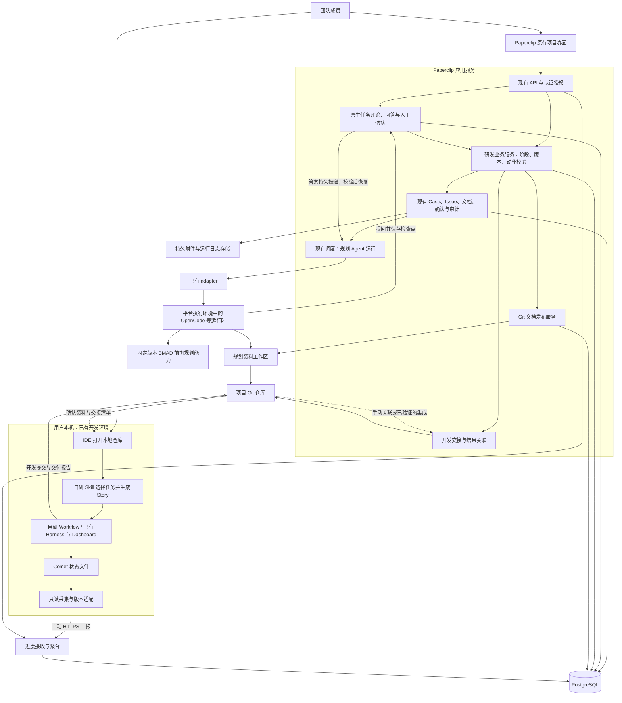
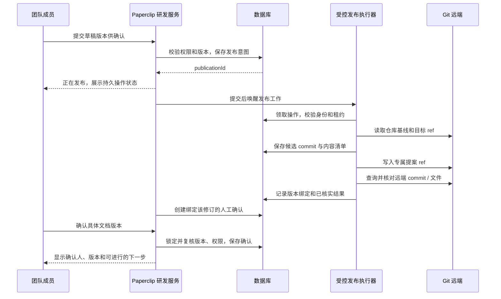

# 团队级 AI 研发平台：技术架构方案

> 创建：2026-11-05；修订：2026-11-08，明确集中部署、Company 与执行环境边界，通过 adapter 调用已有运行时执行 BMAD；复用任务问答和人工确认，保留本地开发、Comet 观察及公司级部署要求。状态：建议实施方案，尚未实现或通过端到端验证。
>
> 产品依据：[产品形态文档](../团队级AI研发平台-产品形态.md)。源码依据：2026-11-05 核验基线 `b3da1d886`；任务问答、人工确认和 Agent 配置依据 2026-11-07 核验的 `3d3485478d6ea1e80c0b329f4423cd2df818b855`，详见第 15 节。本文分别说明已核实的复用基础、需要开发的能力及验收条件。
>
> 已确定的交互约束：用户进入项目后，页面结构、导航、任务列表和详情交互与 Paperclip 保持一致。用户发起规划任务，通过评论、结构化问题和确认卡片参与；不建设独立聊天中心，也不要求多人共同讨论。
>
> 已确定的开发边界：用户直接在本地 IDE 中打开项目，开发、调试、测试和过程可视化沿用已有的 Harness 工程及 Dashboard。平台负责前期规划、资料交接和团队协作；本文不规划平台内的代码开发执行功能。
>
> 已明确的交接顺序：平台生成并发布 BMAD 前期规划文档及候选任务；用户在 IDE 通过自研 Skill 选择任务并生成 Story，再用自研 Workflow 生成开发文档、代码和验证产物。平台观察 Comet 进度并关联成果。
>
> 2026-11-08 更新规模：100 个团队、峰值约 200 个或更多实际执行的规划任务；内网自建，已有 Kubernetes / 数据库运维团队。200 项目、500 活跃开发工作区保留为独立测试基线。部署路径以[内网部署方案](2026-11-08-on-prem-100-teams-deployment.md)为准；Comet 进度契约见[公司级补充方案](2026-11-07-comet-progress-and-enterprise-readiness.md)。

## 1. 架构决策

建议采用 **Paperclip 团队规划与协作平台 + BMAD 前期规划 + Git 交接 + 本地 IDE / 已有 Harness Dashboard + Comet 进度观察**。

继续维护一个 Paperclip 应用，在现有服务内补充规划与交接业务模块。用户、团队、项目、任务交互、审批、预算和规划运行记录沿用原有机制。新增代码集中解决 BMAD 角色与方法绑定、用户输入到执行恢复的衔接、规划阶段与确认版本的约束、文档与 Git 的可靠关联，以及向本地开发交付明确输入的问题。

Paperclip 作为控制平面管理规划 Agent，通过已有 adapter 调用 OpenCode 等运行时执行需求分析、PRD 和架构生成；BMAD 方法包加载到该运行时的执行环境，不要求自行开发 agent 引擎。平台管理员配置 CLI、模型认证、方法包和仓库权限，普通成员通过浏览器使用规划与审阅功能。进入代码开发阶段后，由用户本地的 IDE 与已有 Harness 接手；平台通过只读采集 Comet 文件维护带来源和新鲜度的进度摘要，并关联交接与交付结果。开发操作与详细 Dashboard 继续由本地环境承载。

| 决策 | 选择及原因 |
| --- | --- |
| 前端 | 沿用 React / Vite 和现有页面、组件、路由、查询缓存；项目内保持 Paperclip 的使用方式 |
| 后端 | 扩展现有 TypeScript / Express 服务；研发业务有独立模块，认证和执行仍由原模块负责 |
| 数据库 | 沿用 Drizzle；团队部署使用 PostgreSQL，单机开发可使用现有 PGlite |
| 团队模型 | 一套集中部署、每团队一个 Company；数据库及 API 保留 `companyId`，不因团队数量复制部署 |
| 登录与权限 | 使用 `authenticated`，组织私网选择 `private` exposure；启用成员关系和资源授权，补足回答、人工确认及研发动作约束 |
| 规划执行 | 复用已有 adapter 和 OpenCode 等运行时；运行在平台服务器、容器或受支持的远程执行目标中 |
| 用户交互 | 复用普通规划任务的评论、问题和确认卡片；不修改个人 Agent Chat 身份，不新增共享会话 |
| 研发流程 | 复用 Case、规划主任务、Agent handoff 和规划运行记录；开发阶段记录对外交接 |
| BMAD | 将角色指令、Skill / Workflow、模板及交互步骤接入选定 Runtime；方法及产物版本固定，等待状态持久保存 |
| Git | 承载确认文档、交接清单和代码版本；平台发布规划资料，本地提交代码 |
| 任务选择与 Story | 在 IDE 中由自研 Skill 结合规划文档及代码上下文完成；平台候选任务不是已生成的本地 Story |
| 开发执行 | 用户本地 IDE + 已有 Harness Dashboard，继续使用本地 Agent、工具许可及执行机制 |
| 开发进度 | 本地只读采集 Comet 文件，主动认证上报；平台保存投影、来源与更新时间，独立维护团队验收 |
| IDE / Dashboard 入口 | 先支持仓库和资料交接、手动打开；已验证的本机集成再提供快捷打开 |
| 插件 | 用于适合的展示扩展；阶段准入、交互恢复、授权及事务一致性通过核心服务的窄接口实现 |
| PoC 部署 | 一个应用服务、一个 PostgreSQL、规划 Agent 执行环境和持久存储；本地开发环境独立 |
| 公司级正式部署 | 首期验证单活控制平面与受控接管、HA PostgreSQL、隔离执行池和持久存储；通过 100 团队、200 实际 run 混合负载验收，超额持久排队；长期 API 多活另行验证 |

初期不引入独立的通用 Workflow 服务、Kafka、向量数据库或第二套用户系统。最小闭环是“用户发起任务 → BMAD 提问 → 用户回答后继续 → PRD 与 Git 提案版本 → 人工确认后继续 → 本地取得交接资料”。平台内 IDE、开发终端、代码 Agent 调度和开发测试面板不属于本产品范围。

## 2. 总体架构与责任边界



这是逻辑架构，不表示每个方框都需要独立部署。

| 模块 | 负责 | 不能替代的边界 |
| --- | --- | --- |
| 项目 UI | 显示任务、问题、文档、待确认事项及错误 | 后端授权和阶段准入校验 |
| 原生任务交互服务 | 评论、问题与确认卡片、接收人、回答记录及持久投递 | BMAD 方法步骤、成果是否足够及后续执行授权 |
| 研发业务服务 | 将意图落实为受控动作；维护阶段输入、确认和失效规则 | 模型执行、Git 凭据解析、通用任务调度 |
| 现有控制面 | Case / Issue 生命周期、单负责人、原子领取、预算、审批、审计 | BMAD 业务规则本身 |
| adapter 与规划运行时 | adapter 调用已有运行时，由其加载 BMAD、执行规划及文档校验并调用交互工具 | 本地代码开发、开发测试、用户机器的进程控制 |
| Git 发布服务 | 校验文件、记录发布意图、提交及验证远端结果、处理冲突 | 把一条任务回复认定为已发布成果 |
| 开发交接 | 固定资料版本、记录去向、关联本地提交的交付结果 | 运行本地任务或代替本地 Dashboard |
| Comet 进度观察 | 只读采集、认证上报、来源绑定、最新状态与新鲜度 | 执行 Comet 转换、恢复本地文件或自动替代团队验收 |
| IDE + 自研 Skill / Workflow + 已有 Harness | 任务选择、Story、开发文档、代码、调试、测试和运行可视化 | 自动改变平台上的需求确认和团队验收记录 |

BMAD 提供工作方法和文档规则，平台负责谁可以做什么、哪些版本已被确认、下一步能否启动。模型提出阶段推进建议，服务端依据持久状态决定是否执行。

这里的服务端准入适用于平台规划和发布操作。平台能决定是否生成有效交接、是否接受某份交付结果，无法阻止持有本地仓库的用户自行修改代码。平台记录的状态应体现这项边界。

## 3. 页面架构：项目内保持 Paperclip 交互

当前 `ProjectDetail` 已包含项目标题、摘要、Tasks、Configuration、Budget，以及按条件显示的 Workspaces 和插件页签；项目根路由会恢复上次访问页签，否则进入任务列表。侧边栏还存在不同界面模式。实施时以实际启用的模式为基准，不硬编码另一套侧边栏布局。[项目页源码](../../ui/src/pages/ProjectDetail.tsx)、[侧边栏源码](../../ui/src/components/Sidebar.tsx)。

建议的页面接入方式：

| 位置 | 接入内容 | 交互规则 |
| --- | --- | --- |
| 公司切换与 COMPANY | 产品文案改为团队、成员和权限 | 保留原有公司作用域与访问控制 |
| AGENTS | 预配置项目协调、产品、架构及需求评审角色 | 沿用 Agent 详情和规划运行记录；本地开发角色仅作为交接说明 |
| 项目顶部 | 增加“发起规划”操作和待处理提示 | 创建关联项目的普通研发任务，沿用原生详情打开方式 |
| 项目顶部 / 相关任务 | 增加“本地开发”入口 | 查看交接清单、复制仓库地址；本机集成可用时打开 IDE 或已有 Dashboard |
| 项目摘要 | 展示需求进展、当前成果和等待人处理的事项 | 摘要是派生信息，点击回到原始工作或确认记录 |
| Tasks | 展示规划任务、关联工作的 Comet 阶段及交付摘要 | 复用原有交互；显示来源和新鲜度，详细执行状态归本地，不重复维护 Harness 子任务树 |
| 原生任务详情 | 讨论、提问、文档、差异、确认卡片、运行记录 | 研发阶段和关联 Case 使用现有属性区及关联入口 |
| Configuration | 配置仓库、AI 角色绑定、BMAD 版本和确认规则 | 只向有配置权限的人开放 |
| 文档聚合 | 后续可增加同风格的项目页签 | 聚合已有文档和工作产物，不复制出第二套正文 |

研发工作使用原生任务地址、评论和交互卡片。项目页的原有默认、记忆、返回、面包屑和深链接行为保留；不增加固定项目会话路由，也不把个人 Agent Chat 改成项目共享身份。

前端新增查询键必须包含团队和项目作用域；切换团队、退出登录或权限失效时清除相关缓存和订阅。只在服务端确认权限和动作成功后更新最终状态，失败时保留可恢复的输入并显示原因。后续 UI 实现遵守仓库 `DESIGN.md` 的 token 规则。

## 4. 复用范围与需要补齐的能力

| 已核实基础 | 本产品可复用部分 | 必须补齐或验证 |
| --- | --- | --- |
| Company、Projects、成员和资源授权 | 团队、项目、登录后的访问范围 | 最小权限角色映射；确认相关保护在目标部署中为强制执行 |
| 任务评论与 thread interactions | `ask_user_questions`、确认卡片、回答记录和持久投递 | BMAD 提问映射、显式人工策略、检查点与继续执行的衔接 |
| Cases / Workflow | 一次研发工作的主任务、阶段显示、角色交接及历史 | 当前 Workflow 主要保存指令；研发阶段必须增加版本化准入规则 |
| Issue 文档与修订 | Markdown 草稿、修订历史、并发版本检查 | Git 文件与文档修订的绑定及发布恢复 |
| `request_confirmation` | 绑定具体文档修订的确认交互 | 显式设置 `human_only`、必要时指定接收人，校验 Git 版本和后续动作范围 |
| 项目 Git 授权与工作区 | 已有仓库选择、受控凭据获取和执行位置 | 不能把绑定仓库理解为所有成员可写；需可靠发布文档 |
| 运行、预算、工作产物 | 执行状态、成本约束、PR / 文件等成果引用 | 将其与研发工作及输入产物版本关联 |

现有 `workspace_operations` 记录命令、退出状态和日志证据；本文不将它直接当作文档发布的持久事务记录。选用的 Case 路径仍需完成针对本产品的兼容和验收；Agent Chat 不属于本方案依赖。原生卡片存在不代表 BMAD 等待 / 恢复和阶段准入已经完成。[交互服务](../../server/src/services/issue-thread-interactions.ts)、[Case 结构](../../packages/db/src/schema/cases.ts)、[Workflow 结构](../../packages/db/src/schema/workflows.ts)、[工作区操作结构](../../packages/db/src/schema/workspace_operations.ts)。

## 5. 数据模型

### 5.1 产品对象与现有实体的对应

| 产品对象 | 建议载体 | 说明 |
| --- | --- | --- |
| 团队 | `companies` | 继续使用 `companyId` 作为团队隔离边界；一个企业部署容纳多个团队 |
| 团队人类成员 | 现有用户、公司成员关系和权限 | 与 AI 职责角色分开 |
| 项目、仓库来源 | `projects`、`project_workspaces` | PoC 一个项目绑定一个已有仓库，执行工作区另有身份 |
| 任务内问答 | 现有 Issue 评论及 thread interactions | 隶属具体研发工作，保留作者、接收人、回答和处理状态 |
| 一次需求或研发工作 | `cases` + `workIssueId` | 一个项目可以并行存在多个 Case，各自维护阶段 |
| 工作阶段 | `cases.phase` + 新增控制记录 | 保留现有显示字段，准入依据受保护的版本和确认记录 |
| 阶段交接 | `case_handoffs` | 延续同一主任务的角色交接及执行工作区 |
| 平台规划执行 | 普通 Issue + 现有 run | 一次重试产生执行记录，不生成第二套 WorkflowExecution |
| 本地开发交接 | 现有文档修订 + work products + 控制记录引用 | 固定交接清单，关联本地交付；不把本机运行伪装为平台 run |
| 文档与代码成果 | 文档修订 + 现有 work products | 文档增加 Git 版本映射，代码关联具体 PR / commit |
| 人工决定 | 现有 thread interactions / approvals | 按决定类型使用现有机制；研发文档确认使用版本化 target |

一个 Case 的普通主任务承接需求描述、问答、文档生成和角色交接。一次提问、等待或重试不新建 Case；回答的权威记录使用现有交互数据，不另存一份聊天历史。代码任务交给本地 Harness；平台上的开发工作条目用于负责人、输入和交付结果的关联，不触发平台开发 Agent。

### 5.2 最小增量模型

以下四张表是规划与发布部分建议新增的业务数据。Comet 观察另需来源及变化记录，见[补充方案的数据模型](2026-11-07-comet-progress-and-enterprise-readiness.md)。字段均为逻辑设计，实施时仍需按仓库规范生成迁移与共享类型。

| 建议新增表 | 核心字段 | 约束与用途 |
| --- | --- | --- |
| `project_engineering_settings` | `companyId`、`projectId`、`configVersion`、方法包精确版本及摘要、角色绑定、确认策略 | 每项目一条当前配置；执行开始时固定快照；不存明文密钥 |
| `engineering_case_controls` | `companyId`、`projectId`、`caseId`、`controlVersion`、方法及策略快照、`contextRevision`、阶段尝试编号、`methodStepId`、`checkpointRef`、`waitingInteractionId`、已消费回答版本、输入与确认引用 | 每 Case 一条受保护控制记录；检查点正文可引用文档修订，不接受任意 `fields` 写入替代受控动作 |
| `repo_document_versions` | `companyId`、`projectId`、`caseId`、文档及修订 ID、仓库身份、路径、ref、commit、blob、内容摘要、发布操作 ID | 不可变的“平台修订 ↔ Git 文件版本”映射；ref 仅用于定位，内容以 commit / blob 为准 |
| `repo_document_publications` | 公司、项目、Case、幂等键及请求摘要、发起人、文档修订清单、基线 commit、候选 commit、状态、租约版本、重试信息、错误 | 持久记录跨 DB 与 Git 的发布意图和结果；重启后继续核对，不能靠内存队列恢复 |

本地交接首期不新增一套远程运行数据模型。`engineering_case_controls` 增加当前交接修订引用和 `executionLocation: local_harness` 的受控配置；交接正文保存为不可变的文档修订，发布和结果引用使用现有文档 / work products。开发阶段不创建平台 run；进度来源的存活及状态上报使用独立的观察契约，不参与开发执行调度。

Case 历史复用 `case_events`；为研发检查点和确认变更增加明确事件类型，同步更新数据库约束、共享类型和展示。事件引用原生交互 ID 和修订，不复制答案正文。个人 Agent Chat 的身份字段、唯一约束和生命周期保持原状，本方案不需要会话 schema 迁移。

所有新增数据包含公司作用域；项目、Case、Issue、文档、Agent 的外键引用必须校验同一公司和对应项目。能够使用复合唯一键 / 外键表达的边界由数据库约束保护，其余在同一事务内校验。关键操作按 `(companyId, projectId, operationKind, idempotencyKey)` 去重，同一键携带不同请求摘要返回冲突。

### 5.3 数据的权威来源

| 数据 | 权威来源 |
| --- | --- |
| 成员、权限、消息、Case、规划任务及运行、交接、确认 | 平台数据库 |
| 正在编辑的文档草稿 | 平台文档及其修订；由 `baseRevisionId` 保护并发写入 |
| 已发布、供确认的文档内容 | Git 中的精确 commit + path + blob，并保留平台修订快照 |
| 某一版本是否已确认 | 平台中的确认记录及受保护的版本绑定 |
| 当前项目摘要、进度、待处理数量 | 从上述记录派生，可重新生成 |
| Runtime 会话缓存 | 执行辅助状态，丢失后可由持久上下文重建 |
| 本地开发进程、细粒度进度和日志 | 已有 Harness Dashboard 与 Comet 状态文件；平台保存带来源、采集健康和时间的观察投影 |
| 代码提交、PR 及其合并状态 | Git 及其托管服务；本地自行报告的结果先标记来源，核验后再用于验收 |

文档被确认、提交到提案分支、合并到默认分支，是三个不同的事实。它们各有状态和证据。

## 6. 登录、团队和项目权限

### 6.1 登录与资源隔离

团队部署使用现有 `authenticated` 模式和认证集成；自托管可沿用现有 Better Auth 路径。`local_trusted` 用于个人本机开发，不能作为团队登录隔离方案。平台无需为这项产品重新搭建账户系统。[部署与认证模式](../DEPLOYMENT-MODES.md)。

请求依次校验：已登录身份 → 当前有效公司成员关系 → 项目可见性 → 具体动作权限 → 关联资源范围。资源详情采用现有可访问资源加载方式，对无权访问的项目保持一致的不可见响应，避免通过 ID 探测泄漏存在性。

公司级部署承载多个 Company / 团队。企业登录不自动授权所有项目；跨团队协作与公司级汇总使用明确的成员及项目范围，搜索、统计、导出和实时订阅同样过滤。组织模型和进度来源最小权限见[公司级补充方案](2026-11-07-comet-progress-and-enterprise-readiness.md)。

现有授权代码有执行模式、管理员例外及代用户身份路径。团队验收必须证明目标部署使用强制权限校验，不能只检查前端是否隐藏项目。实例管理员属于部署运维信任边界，应单独控制，不能把普通团队管理员自动当成实例管理员。[公司访问检查](../../server/src/routes/authz.ts)、[项目授权实现](../../server/src/services/authorization.ts)。

`project_memberships` 的加入、离开和收藏主要影响工作区呈现；访问私有项目应使用已有的项目访问授权体系。具体私有功能还需核对目标版本的功能开关和 entitlement，不能仅改名称就宣称可用。

### 6.2 人类权限与 AI 职责

以下是目标权限，不表示当前角色名称天然具备同样限制。实施时映射到现有授权服务；若现有 `operator` 默认能力偏大，应补充动作权限或收紧产品使用的角色预设。

| 能力 | 团队所有者 / 管理员 | 项目成员 | 只读成员 |
| --- | --- | --- | --- |
| 管理团队成员与 AI 配置 | 按已有管理权限 | 否 | 否 |
| 查看项目资料 | 项目可见范围内 | 项目可见范围内 | 项目可见范围内 |
| 评论、回答问题、编辑草稿 | 有写权限，回答还需符合接收人及解析策略 | 同左 | 否 |
| 发起有成本的 AI 工作 | 需执行权限和预算 | 需执行权限和预算 | 否 |
| 确认 PRD / 架构版本 | 需被指定为确认者 | 需被指定为确认者 | 否 |
| 平台规划资料发布 | 需相应仓库授权及动作许可 | 需相应仓库授权及动作许可 | 否 |
| 创建开发交接、关联结果 | 需项目写权限及有效输入 | 需项目写权限及有效输入 | 否 |

本地代码修改、推送、PR 和合并使用用户已有 IDE、Harness 与 Git 权限；平台成员身份不授予这些本机权限，也不收集本地凭据来代理开发。

AI 的“产品经理”“架构师”等是职责与能力配置，不能直接映射成团队管理员。Agent 有效能力受团队 / 项目访问、发起人的有效委托、当前动作、Runtime 工具权限和仓库凭据共同约束。

任务评论、问答、关联成果和运行详情都继承项目范围；不能通过单独分享底层 Issue、附件链接或跨项目 Case 关联扩大可见范围。通用分享和关联入口也必须执行这项约束。必须人工处理的交互设置 `resolverPolicy: human_only`，可用 `addresseeUserId` 进一步指定接收人；产品确认规则仍需校验其当前有效授权。

### 6.3 执行中的身份与撤权

每条消息保留真实作者；每个有副作用的操作固定发起人、授权依据、目标和输入版本。后续发言者不自动接管此前的仓库授权，先前的管理员发言也不能让后来的普通成员继承管理员能力。

入队、开始执行、取得敏感工具或 Git 凭据、确认阶段结果时重新校验有效权限。用户被移除后拒绝其排队工作和后续受控动作，触发相关运行的停止或收敛；已签发的凭据需按连接能力撤销或等待短期凭据过期。停止信号不能撤回已经发生的外部操作，必须核对并记录最终结果。

上述运行控制针对平台规划与发布任务。本地 Harness 的停止、预算和工具权限由本地机制负责；平台撤权后拒绝新的资料读取或结果写入，但不能收回已克隆文件，也不能宣称本机进程已停止。Git 服务的用户权限独立撤销。

附件、日志、搜索、导出、实时订阅和缓存同样属于授权面。订阅先鉴权，事件只作为更新提示，取详情再鉴权；使用存储下载地址时按现有策略限制有效期和访问范围。

## 7. 任务内人机交互与执行恢复

### 7.1 复用原生交互

BMAD 的交互步骤通过选定 Runtime 可调用的 Paperclip 工具接入普通规划任务，不依赖个人 Agent Chat 或新的聊天服务。

| BMAD 需要的用户输入 | Paperclip 承载方式 | 必须明确的语义 |
| --- | --- | --- |
| 需求补充、约束和选项 | `ask_user_questions` | 问题 ID、允许答案、接收人、回答版本及所对应的方法步骤 |
| 对具体文档版本作决定 | `request_confirmation` | `issue_document` 修订 target、`human_only`、有效确认者和允许的后续动作 |
| 多项逐条勾选或判定 | 已有 checkbox / item verdict 交互，实际需要时启用 | 哪些项目必须完成、拒绝或部分通过如何影响后续步骤 |
| 自由补充、修改意见 | 原生任务评论 | 保留作者及来源；评论不自动回答问题或接受确认卡片 |

原生交互默认解析策略可能允许 Agent，包括创建卡片的 Agent；必须人工回答或确认的步骤显式设置 `resolverPolicy: human_only`，需要指定人员时设置 `addresseeUserId`。通常保留 `supersedeOnUserComment: false`，避免普通评论使待处理卡片失效。授权按当前成员及项目范围检查，卡片接受不额外授予工具或仓库权限。[交互契约](../SPEC-implementation.md)、[交互服务](../../server/src/services/issue-thread-interactions.ts)、[原生交互卡片](../../ui/src/components/IssueThreadInteractionCard.tsx)。

### 7.2 提问、等待与继续

目标执行协议：

1. Agent 运行固定版本的方法步骤，发现缺少必要输入时生成问题及检查点，记录方法步骤、输入修订、尝试编号和待处理交互引用。创建卡片与保存等待状态必须具备事务或持久意图恢复机制，不能出现卡片丢失后流程自行推进。
2. 检查点持久化后，本轮执行结束或通过已验证的 Runtime 机制挂起并释放资源。不能让 CLI 一直阻塞在 stdin，也不能靠心跳反复启动模型询问同一个问题。
3. 用户在原生卡片提交答案。现有交互服务校验身份、卡片状态和答案结构，将回答和持久投递记录落库；评论回复不能绕过这一步。
4. 复用现有 delivery coordinator 和交互继续策略投递后续工作。问题、拒绝、接受可使用不同策略；`none`、`wake_assignee`、`wake_assignee_on_accept` 按具体交互与目标行为选择，不能把所有卡片统一当成“接受后立即执行”。
5. 恢复前重新校验权限、预算、任务是否可运行、控制版本、输入修订和等待的交互 ID。暂停、归档或已结束的工作不能因为历史答案再次启动；过期答案保留为历史，提示重新处理。
6. 在锁定控制记录的事务内消费当前有效的回答版本并保存下一步派发意图，重复投递不重复推进。Runner 可恢复现有会话，或用持久检查点重建新运行；必须验证选定 Runtime 的实际行为。

卡片本身不是 BMAD 流程锁。普通评论、任务更新或自动唤醒仍须经过受控工作的执行准入，必要输入未齐时不得推进依赖步骤。需要处理补充意见时可以安排受限的澄清或修订动作，但不能因此消费未确认的成果。新的问题取代旧问题时保留历史并显式更新检查点引用。

这些是接入契约；已核实的是原生问题、回答持久投递和确认基础，尚未验证 BMAD 在选定 Runtime 中的端到端等待与恢复。

### 7.3 上下文来源

按优先级组装：当前任务描述及有效回答 → 当前 Case 的确认版本、检查点及待决问题 → 项目有效约束 → 相关文档和仓库片段 → 有出处的工作摘要 → 有限数量的近期评论。引用其他工作的资料需有明确关联及访问授权，不自动引入个人聊天历史。

每次执行固定项目、Case、任务、来源评论与交互 ID；记录方法包精确版本及摘要、角色和 Runtime 配置、`methodStepId`、检查点修订、已消费回答版本、`contextRevision`、输入文档及 Git commit、允许动作、发起人 / 委托身份和预算。后来回答问题的人不会自动取代原动作的授权主体。

结论分为已确认决定、AI 推断和待确认事项；AI 摘要不能自行升级为团队决定。检索前按当前有效权限过滤，不能先跨团队取回内容再交给模型筛选。PoC 使用数据库查询和按允许路径读取仓库即可，不预先引入向量检索。

项目级有效约束由有修订号的文档承载，各 Case 记录依赖修订。约束更新后，推进时同时核对来源版本和 Case 上下文版本。需求归属不清楚时通过问题卡片澄清，项目不维护一个全局唯一的“当前 BMAD 阶段”。

## 8. BMAD 接入与研发阶段控制

### 8.1 方法包接入

BMAD 作为受控方法包安装到选定 Runtime 的执行环境。Paperclip 管理 Agent 的身份、配置、权限、预算及运行记录，adapter 负责调用运行时，OpenCode 等运行时实际执行任务，BMAD 提供方法内容；“迁移虚拟角色能力”需要以下映射，而不只是复制 persona：

| BMAD 能力 | 接入 Paperclip 的位置 |
| --- | --- |
| 角色职责、行为指令 | Agent 指令及角色配置；角色名称不授予权限 |
| Skills、Workflows、任务规则及模板 | 固定版本的方法包，安装到 Runtime 可读取的位置 |
| 需求与输入文档 | 当前规划任务、授权的项目资料及版本引用 |
| 提问、确认、等待与继续 | 原生交互工具 + 受保护检查点 + 持久回答投递 |
| 生成的规划文档 | 原生文档修订、校验、Git 版本映射及发布流程 |

实际接入选择经过验证的精确发布版本或提交，并固定安装产物摘要；本文不指定未经本次验证的“最新版本”。升级单独做兼容迁移，不能混用不同版本的命令、目录、角色或步骤定义。[BMAD 官方安装说明](https://docs.bmad-method.org/start/install-bmad/)、[Skills 与 Agents](https://docs.bmad-method.org/reference/skills-and-agents/)。

PoC 固定一个产品经理 Agent、一种现有可用 Runtime 和一条规划 Workflow，先验证真实加载、提问、人工确认、恢复和产物。将原本面向 IDE / 终端用户的输入步骤适配为原生交互工具，不以强制自动回答代替人工决策；只有现有专用 adapter 或通用 `process` / `http` 接入无法满足运行协议时，才开发或扩展 adapter。Case Workflow 可保存阶段指令，但其文字不能替代方法版本、工具权限或阶段准入。BMAD 业务留在研发模块，Provider 协议留在现有适配层，不将方法步骤塞入通用 heartbeat 调度主逻辑。

最低执行证据包括方法包安装清单与摘要、运行加载记录、使用的输入版本、产物文件与验证结果。出现一份名为 PRD 的文档，只能证明有该文档；这些证据也不能自动证明模型完整遵循了所有方法步骤，仍需内容验收。

### 8.2 阶段与任务组织

PoC 只验证一条 PRD 规划路径，之后补齐完整规划和简化路径；阶段集合由平台版本管理，不先实现可视化流程编辑器。

| 阶段 | 典型角色 | 输入与输出 | 推进条件 |
| --- | --- | --- | --- |
| Analysis | 协调助手 / 分析角色 | 想法、现状、约束 → 简报及待决问题 | 必需信息充分；重大假设已显式记录 |
| Planning | 产品角色 | 有效需求上下文 → PRD / 范围 / 验收标准 | 所要求的具体文档版本通过指定人员确认 |
| Solutioning | 架构角色 | 已确认需求与仓库基线 → 架构、候选任务及依赖 | 方案针对有效输入版本，所需确认和检查完成 |
| Implementation（本地） | IDE 中的自研 Skill / Workflow + 已有 Harness | 选任务 → 生成 Story → 开发文档、代码、测试、PR | 平台记录交接，按关联结果及团队验收确认交付；执行由本地负责 |

这是本产品的流程配置，不声称所有 BMAD 版本要求每项工作都依次完成这些阶段。小改动可以选择简化路径；省略阶段需由受控规则和有效授权决定，并记录原因。

一项研发工作使用一个 Case 和普通主任务；分析、规划、架构阶段需要分工时，通过现有 handoff 更换负责 Agent，同时传递有效检查点和输入引用，保持任务单一负责人。进入 Implementation 时生成本地开发交接记录，平台不向开发 Agent 派发任务。现有 `case_handoffs` 只用于平台内支持的角色交接，不把 IDE 地址或本机进程塞进 Agent handoff 目标。

### 8.3 服务端阶段准入

研发控制模块提供少量明确业务动作，例如开始规划、提交待确认版本、应用确认、转入下一阶段、重新打开工作。每次推进在一个数据库事务内：

1. 锁定控制记录、Case 和相关任务；校验公司、项目及当前主体权限。
2. 比对 `controlVersion`、Case handoff 版本、Issue 状态版本、当前阶段尝试和输入文档版本。
3. 校验本步必要回答已被有效消费、所需产物存在、Git 发布结果已核实、指定人工确认有效，且输入没有被更新。
4. 若下一步仍是平台规划，校验目标 Agent、预算、工作区及动作许可并保存派发意图；若进入本地开发，保存不可变交接及来源版本，不产生平台执行意图。
5. 提交后仅对平台规划唤醒任务，并在派发时重新检查权限和版本；本地交接通过项目原生入口供用户取得。

确认只证明“某人确认了某一版本用于指定目的”。PRD 确认默认允许把该版本作为后续规划依据；完整开发交接还要满足本次需要的架构、任务及验收标准。取得交接资料不等于授权平台远程控制 IDE。

Case `phase` 展示业务阶段，Issue `status` 表示该工作的协作状态，平台 run 只表示平台执行。UI 的“等待回答”“等待确认”“已交接本地”“待验收”由检查点和交互 / 交接 / 结果记录派生；不为展示状态随意增加通用 Issue 枚举，也不通过平台 run 模拟 Harness 内部状态。回答问题与批准成果是不同动作，前者不能替代后者。

### 8.4 防止绕过与过期结果

准入校验要接到管理中的 Case handoff、文档确认解析及任务执行准入边界。仅在新增 API 中校验还不够：直接操作原有 Issue / Case API、Agent 原生工具或修改 `phase`，也不得绕过受控工作的要求。

相关核心模块只调用窄的领域校验接口，BMAD 业务逻辑集中在研发模块。普通非研发任务和功能关闭状态保持原有行为。旧 run 晚到的结果可以留作历史证据，但版本不符时不能覆盖新产物或推进阶段。

本产品管理的 Implementation 工作必须在执行准入中阻止平台开发派发，包括通用任务更新接口引起的间接唤醒；交接动作本身不注册本机 Runner。保留 Paperclip 其他既有任务能力，并不意味着本产品会展示或使用这些开发能力。

需求发生实质变化时增加 `contextRevision`，标记旧交接需要更新并生成新版本；历史确认和交接保留。平台规划任务按准入规则暂停或重新规划；本地开发由用户或后续接入的 Harness 根据变更决定如何处理，平台不宣称已经远程中断它。

### 8.5 开发交接清单

平台在本次需要的规划产物确认后生成交接清单。它把“这次开发依据什么”固定下来，供用户、IDE 中的 Agent 和现有 Harness 使用。初版使用 Git 文件和原生任务文档即可，不要求 Harness 立即实现新的服务接口。

| 内容 | 建议字段或引用 | 用途 |
| --- | --- | --- |
| 契约与交接版本 | `schemaVersion`、`handoffId`、创建时间、`supersedesHandoffId` | 区分格式与每次不可变交接，支持更新后的替代关系 |
| 平台来源 | `companyId`、`projectId`、`caseId`、相关工作 ID | 关联回原始需求；这些标识本身不授予访问权限 |
| 仓库与代码基线 | 仓库提供方 / ID / URL、`codeBaseCommit`、建议分支 | 明确开发对象；以 commit 固定基线，分支名只作提示 |
| 确认的输入 | PRD、架构、候选任务、验收要求的文档修订及 Git commit / path / 内容摘要 | 本地 Skill 用这些输入生成 Story；Story 不作为交接前置条件 |
| 范围与约束 | 目标、非目标、技术约束、依赖、未决问题的版本化引用 | 让本地开发理解任务边界 |
| 方法配置 | BMAD 方法版本、允许共享的配置摘要及角色说明 | 让本地适配所需方法；不携带密钥或平台私人上下文 |
| 结果关联方式 | 平台工作链接及期望的 commit、PR、验收证据类型 | 开发完成后能追溯到对应交接 |

交接文件采用项目约定的中立目录，例如 `docs/engineering/handoffs/<handoffId>.json`，同时生成便于阅读的 Markdown 说明；此处是拟议格式和路径，不是声称 Harness 已有该协议。接入时优先适配用户现有的 Harness 文件约定，不覆盖其现有配置。交接文件自身的发布 commit 记录在平台版本映射中，不在文件中写入会形成循环依赖的自身 commit。

交接状态来自平台控制记录和文档修订：资料可用、已交接、已被新交接替代、结果待验收。详细的开发执行状态继续由 Harness 管理。每份交接保留原版本，不因需求修改而原地重写。

### 8.6 用 IDE 打开项目

首期保证用户可以取得正确仓库和交接版本，直接在现有 IDE 中打开项目。快捷打开按本机已有能力逐步接入：

| 场景 | 交互与实现边界 |
| --- | --- |
| 已有本地仓库 | 在 IDE 中打开该目录，取得交接指向的资料；核对仓库身份、代码基线与文档版本 |
| 首次开发 | 提供复制仓库地址和交接文档入口；用户用现有 Git / IDE 流程克隆，再打开本地目录 |
| 已配置 IDE 协议或现有 Harness 启动能力 | 用户点击后由本机处理打开操作；目标路径和协议经过本机校验，无法打开时保留手动方式 |
| 已有 Harness Dashboard 正在本机运行 | 打开用户配置的本机入口；是否支持直接定位项目，以该 Dashboard 的实际能力为准 |

平台服务端的规划工作区路径与用户本地目录是两种资源。一个项目在不同成员、设备上可对应不同目录，本地路径及 Dashboard 端口保存在本机偏好中，不能写成整个团队共用的项目路径。浏览器中的 `localhost` 指向使用浏览器的机器，不是 Paperclip 部署主机。

“打开 IDE”是用户主动打开应用，不代表平台自动开始克隆、安装依赖或执行开发。首次打开、未安装协议处理器或没有本地桥接时，应说明如何手动取得资料；不提前宣称一键启动已可用。若未来需要本机桥接，优先复用现有 Harness，并对来源、身份、目录及允许动作校验，不提供任意远程 shell 执行接口。

取得交接资料时保留用户未提交的改动。需要使用不同基线时，由用户选择分支、独立工作区或合并策略；任何本地适配都不能自动执行破坏性 reset 或覆盖工作目录。规划资料来自提案 ref 时，应提供可读取该 ref 的方式，不能假设它已经进入默认分支。

### 8.7 开发结果关联与变更往返

最小方案允许用户在原有工作条目中关联 commit、PR 和测试报告，携带 `handoffId` 或对应交接修订。平台使用现有 work products、文档与活动记录保存结果，不导入整套本地日志、会话和子任务状态。

结果至少记录来源、提交人、上报时间、仓库、代码版本、交接版本和验证摘要。显示“用户提交”“Git 已核实”“团队已验收”等不同事实：创建 PR 不代表代码已合并，报告声称通过也不等于平台重跑了测试。通过仓库连接核对证据时重新校验项目范围；自动读取 URL 仅通过已配置提供方，不任意访问报告里的网络地址。

Comet 进度主动上报已纳入正式产品范围，具体机制见下一节；交付证据仍可手动关联。Harness 的结果导出和 Git webhook 按实际协议接入，使用项目范围的认证、事件标识去重及输入版本校验。成员撤权后拒绝新的上报。

本地离线时保留最后一次报告及时间，显示未更新；不能因为没有心跳就标记开发失败。旧交接的迟到结果保留为该版本的历史，不能直接完成新需求。需求变更回到关联规划任务，修订并重新确认后生成新交接，由用户或已有 Harness 选择如何继续本地工作。

### 8.8 Comet 开发进度观察

平台通过已有 Harness 的只读采集能力取得 Comet 文件快照，并关联团队、项目、开发工作区、变更及交接版本。开发者电脑使用主动 HTTPS 上报；只有服务端可访问的受控挂载目录才能就近直接读取。Git 远端只反映已推送文件，不能替代未提交状态的采集。

原生项目 / 任务详情展示 Comet 阶段、验证摘要、来源健康和更新时间。平台业务阶段、本地报告阶段与团队验收独立保存；Comet `archive`、Run 完成或本地验证通过均不自动完成团队验收。多个工作区分别呈现，不互相覆盖。

采集保证不写状态文件、不触发恢复 / 迁移、不推进阶段。协议需处理版本差异、写入竞态、重复及乱序、离线补传和来源撤销。已核实文件布局、读取函数的副作用边界、拟议接口及全部验收目标见[Comet 与公司级补充方案](2026-11-07-comet-progress-and-enterprise-readiness.md)。

### 8.9 本地任务选择、Story 与 Workflow 的交接契约

平台提供版本固定的规划输入和候选任务。用户在 IDE 中通过自研 Skill 选择任务、读取当前代码上下文并生成 Story；自研 Workflow 消费 Story，生成开发文档、代码及验证产物。平台不要求本地流程使用 BMAD 命令，也不根据平台规划角色配置改写已有开发 Workflow。

接入优先适配现有本地文件格式。至少能关联：交接版本、规划输入版本、来源任务标识、Story 标识或文件引用、工作区、Comet 变更 / Run，以及最终代码和验证证据。这些是跨系统映射要求，不表示 Comet 状态文件已经原生包含所有字段；需要时由本地适配器读取现有 Story 元数据或独立映射记录。

任务选择和 Story 创建是本地动作，平台随后观察其关联和进度。一个候选任务可拆为多个 Story，也可能在多个分支上尝试，不能按名称或一对一假设覆盖记录。若没有可靠关联，先显示为项目中的未关联来源，由有权限的人建立对应关系。

规划文档的正式更新由平台修订 / 确认链管理；本地生成的 Story、实施文档和代码由本地流程管理。平台通过 Git 关联已推送的成果，进度则通过采集协议独立上报；可看到尚未 push 的开发状态，不等于已经取得这些本地产物的内容。

开发中对原需求或架构提出修改时，将变更带回关联规划任务，形成新修订及必要确认，再发布新交接。已存在的 Story 保留其输入版本，并标记需要重新核对，不在后台覆盖正在开发的文件或自动宣称本地流程已停止。

## 9. 文档、Git 与确认的一致性

### 9.1 文档工作方式

PoC 先支持一个已有 Git 仓库、Markdown 文档、受控提案分支及人工确认。仓库可以在项目创建后再关联；未关联时可以讨论和保存草稿，但不能显示“已发布到 Git”或完成要求 Git 版本的确认。

AI 生成文件后，由产物接收逻辑校验允许路径、类型、大小和内容，保存为平台文档修订。用户在现有文档组件中阅读、编辑或让 AI 修改；保存携带 `baseRevisionId`，并发冲突返回可处理的错误。Git 管理的规范文档采用 `lockedDocumentStrategy: "conflict"`，不能在锁冲突时悄悄另建同名语义的文档。[现有文档服务](../../server/src/services/documents.ts)。

输出路径使用项目配置和固定版本 BMAD 的实际约定，例如映射至受控的研发文档目录；不在所有版本中硬编码一个假定的 BMAD 路径。每个文档引用都能追溯到 Case、运行、输入版本和修改摘要。平台写入范围限定为规划资料和交接文件，代码修改、开发测试和代码提交由本地完成。

### 9.2 发布流程



建议每次发布使用带 Case 与操作 ID 的专属提案 ref，提交的父版本、文件内容和提交元数据固定。重试复用同一个候选 commit，不能每次生成新的提交。写远端前持久保存候选 commit 标识和可重建内容，并按预期目标 ref 校验；若 ref 已存在且指向预期 commit，就继续核对结果。

提案 ref 的名字是平台约定，不等于 Git 天然禁止修改；服务禁止覆盖已发布候选，并在确认时核对 commit / blob，而非只读取分支最新值。保护默认分支，合并按仓库规则另行处理。

Git 与数据库没有共同事务。发布采用“持久意图 → 外部操作 → 结果核对 → 状态落库”的过程，按至少一次投递设计，通过幂等操作得到唯一可观察结果。远端结果未知时显示“正在核对”或阻塞，不能凭超时判定完全失败后重复写入。

### 9.3 确认绑定什么

复用 `request_confirmation` 的 `issue_document` target，绑定原始文档修订，同时通过 `repo_document_versions` 固定：公司、项目、Case、方法 / 策略快照、上下文修订、仓库身份、路径、commit、blob 及内容摘要。多份必需文档分别确认，并在阶段控制记录中形成完整输入集合。

创建确认前和确认生效时，都在锁定条件下检查目标仍然有效；显式设置 `resolverPolicy: human_only`，按需设置 `addresseeUserId`，并校验项目规定的确认者权限，不能沿用允许 Agent 解析的宽泛默认策略。普通评论不能代替卡片接受。现有服务已有文档修订 target 校验；仍需接入 Git 绑定、研发上下文及阶段准入校验，覆盖直接调用原有接口的情况。[现有修订 target 校验及确认服务](../../server/src/services/issue-thread-interactions.ts)。

PRD 使用明确的文档 key，例如 `prd`，不复用具有任务计划执行含义的 `plan`。必须验证确认 PRD 不会意外触发现有“接受计划并开始执行”的路径。

确认后的新修订是一份新候选。旧版本的确认记录继续可查看，但不能充当新版本的批准。通过默认分支上的路径打开文档时，也要明确那是当前仓库文件还是本次已确认快照。

### 9.4 冲突与故障规则

| 情况 | 系统行为 |
| --- | --- |
| 两人同时修改同一草稿 | 后保存者基于旧修订时返回冲突，展示双方版本；不静默覆盖 |
| 多个 Case 修改同一路径 | 发布记录包含各自基线；采用受控合并或重新生成候选，各自确认不互相代替 |
| 外部提交更新了目标文档 | 标记基线变化，读取差异；需要更新内容时生成新修订并重新确认 |
| 默认分支有新提交 | 旧候选仍代表其固定基线；后续整合重新检查相关输入，不宣称候选等于最新默认分支 |
| 推送成功但网络响应丢失 | 查询专属 ref 与候选 commit；一致则补记成功，不能重做一个不同提交 |
| 推送成功但 DB 回写失败 | 由持久发布意图恢复和核对，远端候选保留，待状态落库后再创建有效确认 |
| 发布工作超时后被另一进程接管 | 使用租约版本防止旧进程落库；Git 使用固定候选和预期 ref，避免迟到写入覆盖新结果 |
| 凭据撤销、项目归档或权限变化 | 停止新副作用；已发生结果仍进行最小必要核对并审计，不自动升级授权 |
| Git ref 被删除或改写 | 使用已存快照保留审阅证据，显示远端异常；恢复可验证版本后再允许依赖它的动作 |

数据库租约不能单独阻止 Git 外部副作用，因此专属 ref、预期 ref 校验和固定候选 commit 必须同时存在。外部变更监听可先采用进入相关操作前主动拉取；接入 webhook 后验证签名、去重并对照当前项目仓库配置。

项目 Git 授权与某次 Agent 执行的授权保持分开。现有服务已经区分工作区主机操作和具体 run，并检查关联仓库；文档发布要通过授权模块取得本次所需的有限凭据，不能复用某位管理员的长期全局 token。[项目 Git 授权](../../server/src/services/project-git-authorization.ts)、[项目仓库绑定](../../server/src/services/projects.ts)。

## 10. API 与模块落点

### 10.1 对外业务接口

下面是建议新增的契约形状，并非当前已经存在的 API。具体命名与仓库现有 validators、错误和路由规范一致。

| 建议接口 | 用途 | 核心校验 |
| --- | --- | --- |
| `GET /api/projects/:projectId/engineering` | 返回配置摘要、当前研发工作及有效动作 | 项目读取权限；对返回的关联资源再次过滤 |
| `POST /api/projects/:projectId/engineering-work` | 从用户需求描述创建或关联 Case 和普通主任务 | 发起人、当前上下文、动作范围及幂等键 |
| `POST /api/cases/:caseId/engineering-actions` | 开始规划、提交确认、推进或重新打开 | 有限动作枚举、预期控制版本、输入引用、主体权限 |
| `POST /api/cases/:caseId/document-publications` | 请求发布指定文档修订 | 文档归属、版本、文件范围、Git 动作授权 |
| `GET /api/document-publications/:id` | 查询发布与恢复结果 | 从操作所属项目判定访问权限 |

开发交接复用上述业务接口：为 `engineering-actions` 增加有限的 `prepare_development_handoff` 动作，校验有效输入后生成并发布清单；通过项目聚合接口及原生文档 / work products 读取交接和关联结果。进度观察增加来源注册、快照接收、采集存活、撤销及授权读取接口，具体契约见补充方案；这些接口不具备本机命令、远程终端或开发 run 控制能力。

评论、问题创建与回答、文档修订、确认解析和运行读取沿用现有接口，并扩展必要的业务校验。不新增项目会话 API，也不为 BMAD 复制一套问答接口。配置更新沿用项目配置入口或其专用资源；功能开关、确认规则和方法版本只由有配置权限的人修改。

服务端从认证上下文和已加载资源推导身份及 `companyId`，不能信任请求体声称的用户或公司。Agent 提交的是动作建议及证据引用，不允许直接提交 `approved: true`、任意 SQL 或由模型生成的 shell 命令作为阶段控制指令。

异步动作返回持久操作 / 任务 ID 和已接收状态；HTTP 成功表示意图已保存，不表示 Agent 已完成或 Git 已发布。并发版本冲突使用 `409`，无效业务输入使用现有 `400/422` 规范，身份和权限失败沿用现有一致性响应。

### 10.2 建议代码归属

| 目录 / 现有模块 | 实施责任 |
| --- | --- |
| `ui/src/pages/ProjectDetail.tsx` 与原生详情组件 | 项目入口、研发属性、状态和版本呈现；复用组件，按需抽取公共展示片段 |
| `ui/src/api/` 及查询键 | 新业务接口、公司 / 项目作用域、错误和失效刷新 |
| `packages/shared/` | 研发业务类型、动作 validators、响应契约、Case 事件类型 |
| `packages/db/src/schema/` 与 migrations | 规划 / 发布四张增量表、检查点引用、进度来源及变化记录、事件约束、索引；无个人会话身份迁移 |
| 建议 `server/src/services/engineering/` | 上下文组装、方法配置、规划阶段控制、文档发布、开发交接、进度投影及结果关联 |
| 现有 `issue-thread-interactions`、原生工具及相关 routes | 复用问题、人工确认、接收人及持久回答投递，接入受控工作的继续校验 |
| 现有 authorization / authz | 研发动作、回答与确认的统一授权，禁止外围入口绕过 |
| 现有 Case handoff / 文档确认服务 | 在既有事务中调用窄的研发规则校验，并复用原有交接和确认机制 |
| 现有调度、Runtime、Runner | 执行平台规划任务并报告证据；开发阶段不派发平台 run，Provider 细节留在原有适配模块 |
| 现有连接、凭据与工作区模块 | 文档发布需要的受限凭据、执行位置和结果证据 |

扩展持久后台工作时沿用现有数据库通知与 delivery coordinator，增加对应工作类型、唤醒、停止和恢复处理，不新增一个独立定时扫描循环。工作意图与业务变更在同一事务中持久化，通知丢失时可从数据库恢复。[现有后台工作协调器](../../server/src/services/delivery-work-coordinator.ts)。

## 11. 部署、执行隔离与运行保障

### 11.1 PoC 部署与公司级上线边界

推荐一套 `authenticated` 集中部署，每团队一个 Company。一个逻辑部署可包含多个 API / worker 和执行目标；“集中”描述平台入口与治理方式，不限制为单台服务器或每团队一个进程。组织私网的基本配置如下，公网部署改用 `public` 并满足对应检查：

| 配置 | 选择 |
| --- | --- |
| `PAPERCLIP_DEPLOYMENT_MODE` | `authenticated` |
| `PAPERCLIP_DEPLOYMENT_EXPOSURE` | `private`（组织私网）；互联网访问用 `public` |
| `PAPERCLIP_PUBLIC_URL` | 平台统一的 HTTPS 地址，作为认证和邀请链接等默认值来源 |
| 监听方式 | 按网络选择 `loopback` + 反向代理、`lan` 或 `tailnet`；监听与认证分别配置 |
| 数据库 | 团队部署使用外部 PostgreSQL，正式上线按公司级补充方案满足 HA 与恢复要求 |

首次管理员初始化、镜像和完整配置沿用[部署模式](../DEPLOYMENT-MODES.md)及[Docker 部署说明](../DOCKER.md)，不把个人 `local_trusted` 模式作为团队共享入口。

```text
用户浏览器
    │ HTTPS
反向代理 / 入口
    │
Paperclip 应用：UI + API + 规划调度与交接模块
    ├── PostgreSQL：成员、消息、规划工作、确认、发布与交接记录
    ├── 持久文件存储：附件、文档证据、平台规划日志
    └── adapter → OpenCode 等规划运行时（平台执行环境）
          ├── 固定版本 BMAD 前期规划能力
          ├── 规划资料工作区、文档发布工具和受限权限
          └── 项目 Git 远端及模型服务

用户本机：IDE + 已有 Harness Dashboard
    ├── 本地仓库及开发工具链
    ├── 开发 Agent、调试、测试、开发过程可视化
    ├── 通过 Git 获取交接资料、提交代码，按需关联交付结果
    └── 只读采集 Comet 状态，主动上报进度与采集健康
```

上图单应用、单数据库部署用于 PoC。面向 100 团队、200+ 规划并发，正式部署先验证一个活动控制实例与备用资源、受控接管、HA PostgreSQL、隔离执行池及共享持久存储；继续维护同一个模块化代码库。当前已有数据库失效通知，但其监听限定于部署接管窗口或持有原生执行的进程，不是长期多活保证。并发能力、旧实例隔离与所选 Runtime 的运行恢复须分别验证；API 多活作为实测需要时的后续选项。详见[内网部署方案](2026-11-08-on-prem-100-teams-deployment.md)和[公司级进度与质量契约](2026-11-07-comet-progress-and-enterprise-readiness.md)。

以 `opencode_local` 为例，默认命令为 `opencode`，执行任务时调用 `opencode run --format json ...`，模型需显式配置为 `provider/model`。未选择远程执行目标时，CLI 在 Paperclip server 进程所在环境运行；“宿主机”指该服务的执行主机，Docker 场景下 CLI 必须在容器内可用，而不是只装在容器外的物理主机上。

| 部署 / 执行方式 | OpenCode 的安装与执行位置 | 浏览器用户的安装要求 |
| --- | --- | --- |
| 本机开发，未选择远程目标 | 启动 Paperclip 的电脑，服务进程能解析的命令路径；由该开发者安装并配置认证 | 同机开发者需准备 CLI；浏览器访问本身不要求 CLI |
| Docker，未选择远程目标 | Paperclip 容器内；当前仓库的标准镜像构建包含 OpenCode 等 CLI，自定义镜像需核对 | 使用平台规划、问答和审阅无需个人安装 |
| 服务器直接部署，未选择远程目标 | 运行 Paperclip server 的服务器；管理员安装并配置认证 | 同上 |
| 受支持的 SSH / 托管沙箱执行目标 | `executionTarget` 指定的远程环境；管理员确认 CLI、方法包、认证和网络可用 | 同上 |

集中部署既可直接运行在服务器上，也可使用 Docker。CLI 安装完成不代表配置完成：还需显式模型、有效登录态或授权注入的 provider 凭据、规划工作目录、BMAD 方法包及必要的 Git 访问。认证必须对实际执行目标有效，不能假设沿用浏览器用户电脑上的登录态；远程自动安装取决于目标和安装支持，不作为任意 SSH 环境都可用的承诺。

“个人电脑无需安装”仅适用于平台规划与审阅。后续本地开发仍使用开发者的 IDE、Git、Harness、开发 Agent 和工具链。用户本地 IDE 和 Harness 不注册为平台开发 Runner；不需要为开发阶段建设服务器端代码执行池。

文件存储复用现有接口，可使用持久卷或已配置的对象存储。数据库备份、文件证据和密钥配置需要相匹配的恢复方案；Git 远端并不包含平台的讨论与确认记录。

### 11.2 执行隔离

- Company 的业务数据作用域与访问控制不等于执行环境隔离。未配置独立执行隔离的本地 CLI 使用服务进程可用的主机权限；将多个 Company 放进同一 Paperclip 容器，也不会自动给每个团队建立沙箱。
- 平台同时运行的文档写任务使用受控工作区及提案分支；规划角色交接可沿用同一主任务工作区。本地代码合并由用户的 Git / Harness 流程处理。
- Git worktree 解决文件改动冲突，不能提供安全隔离。不同公司或互不信任项目的执行环境需要 OS / 容器 / Runner 层的文件系统、进程和凭据隔离。
- 平台 API 权限之外，还需要约束 shell、网络、工作目录及可获得的凭据；否则有任意 shell 的 Agent 可以绕过只存在于应用工具中的限制。
- 凭据按连接和当前运行授权获取，避免写入仓库、模型上下文和明文日志；任务检查点不保存成员私人 token。共享服务进程环境中的 provider API key 不能作为团队凭据隔离方案，执行目标需限制实际可见的凭据、挂载目录和网络。
- 任务上下文、运行 session、缓存和工作区按实际公司、项目、任务边界隔离。某个用户的个人 Agent Chat 历史不能自动纳入规划任务。
- 本地开发凭据、工具许可和停止操作留在已有开发环境。平台规划预算只统计和约束平台运行；没有可信的本地成本汇总时，不展示为整个研发过程的总成本。

资源隔离还需验证单 Agent、团队和执行目标三层并发准入，以及目标上的 CPU、内存、进程和磁盘限制。`maxConcurrentRuns` 与唤醒合并不等于主机总并发限制，也不保证同一 Agent 永远串行；SSH 本身不提供资源配额。平台规划优先按事件唤醒，只有业务需要时才启用定时运行。

对 `opencode_local` 显式配置正值 `timeoutSec` 并验证 `graceSec` 后的进程清理。当前目标默认值中，`0` 在本地 / SSH 上没有 adapter 超时，在托管沙箱上使用 4 小时兜底；负值显式关闭 adapter 超时。超时不是 CPU / 内存配额，远程连接中断也不等于进程已终止，需保留停止证据。

### 11.3 恢复和状态展示

| 问题 | 必须具备的行为 |
| --- | --- |
| 进程重启 | 持久任务、等待的交互、检查点和发布操作可恢复，不依赖内存保存步骤，不重复创建问题 |
| 模型或 Runtime 超时 | 记录真实错误，按已有策略有限重试，保留已产生证据 |
| 重复回调或晚到结果 | 以 run、操作 ID 和版本去重；旧结果不修改新检查点 |
| Agent 交接已接收但未执行 | 保持“待派发 / 等待执行”，不能将接收当作完成 |
| 平台规划成本达到阈值 | 复用预算准入、异步阈值暂停和停止机制，重试仍受限制；并发执行及费用迟报可能导致超额，不承诺精确封顶；本地预算独立 |
| 项目暂停或归档 | 拒绝新的平台任务和交接，收敛平台内动作；保留记录，不假称本地已停止 |
| 本地未回报或离线 | 保留上次有效快照及时间，显示过期；采集器在线但读取失败时单独显示采集异常 |
| 停机或空闲休眠 | 停止新派发，完成必要核对和日志落库；唤醒后恢复未结工作 |
| 没有足够信息 | 提出原生问题卡片，保存检查点并释放执行资源，等待答案；重试或自动唤醒不能跳过必要回答 |

审计至少能够串起用户 / Agent → 来源消息 → Case → 规划任务 / run → 文档修订 → Git commit → 确认 → 开发交接 → 关联的交付结果。复用平台运行日志和活动日志；本地详细日志留在 Harness，上传证据按需且显式选择。不把新增业务审计默认发送为遥测。告警聚焦平台权限失败、未完成的发布、规划执行错误、预算停止和证据缺失。

## 12. 分阶段实施

### 阶段 A：团队、产品经理 Agent 与任务问答

完成认证部署、成员权限验证和项目顶部“发起规划”入口。配置一个产品经理 Agent、一个支持的 Runtime 和固定 BMAD 方法包，将第一处用户输入接入原生问题卡片并保存检查点。个人会话保持现有行为。

验收重点：指定用户能看到问题并回答，Agent 从正确步骤继续；未授权用户不能读取或代答，后续回答者不继承发起人的授权；等待不占用模型执行，项目页导航和详情保持一致。

### 阶段 B：可确认 PRD 与最小本地资料交接

在阶段 A 的同一 Runtime 与方法包上，完成一条规划 Workflow 的 PRD 生成、草稿修改、Git 提案发布、`human_only` 版本确认及确认后继续。验证等待中重启、重复回答、过期文档、Agent 自行批准被拒绝及失败恢复。生成最小资料清单，验证用户在 IDE 打开的本地仓库中能取得准确的 PRD 版本。

这是第一个可交付的规划及资料交接闭环；只含 PRD 的清单不自动宣称已经具备完整开发条件。任务访问隔离、人工决策、版本冲突、重复提交及发布结果不确定的处理属于本阶段验收条件，不能推迟到后续“加固”。

### 阶段 C：完整开发交接、Comet 进度与交付关联

增加架构设计、候选任务、依赖和验收要求，形成完整交接。验证用户在 IDE 中通过自研 Skill 选择任务并生成 Story，再由自研 Workflow 生成开发文档、代码及验证产物；接入 Comet 只读进度采集、离线恢复及多工作区关联。平台关联 commit、PR 和验证摘要，支持团队验收及需求变更后的再次交接。代码编写、调试、测试、合并和部署继续使用本地及仓库现有流程。

### 阶段 D：公司级生产验收

完成企业身份接入、跨团队授权汇总、受控故障接管、数据库和文件恢复。按 100 团队、200 实际规划 run 叠加 200 项目 / 500 进度来源执行补充方案及内网部署方案的容量、隔离、容灾和交互验收后分批开放。PoC 可先单实例验证功能，但这些要求不能推迟到全公司正式使用之后。

文档聚合、多仓库、IDE 快捷打开和规划资源进一步扩展按实际使用推进，不改变本地开发职责边界。

### 数据迁移与关闭策略

采用增量迁移加入研发配置、控制检查点、发布和进度数据，不改个人会话 schema。完整应用版本、worker 与数据库迁移一起验证，旧 worker 不得领取其不识别的研发工作类型。

新能力有项目级启用配置和兼容的关闭路径。关闭后停止创建新的研发动作，已有评论、文档和历史可读；待处理交互明确保留为暂停或按授权取消，迟到回答不自动恢复已关闭流程。待核对的外部操作仍需收敛，不通过回滚删除用户数据。Case 及选定 Runtime 的基础开关依赖在配置检查中明确展示。

## 13. 验收矩阵

本表是实施验收要求，本次只完成架构文档，没有执行下列产品验证。

| 场景 | 通过标准 | 建议验证层 |
| --- | --- | --- |
| 团队间隔离 | 列表、直接 ID、搜索、附件、日志和实时通知均不跨公司泄露 | API 集成 + 双用户 E2E |
| 规划执行位置与安装责任 | 未安装 OpenCode / BMAD 的浏览器客户端能完成规划问答和审阅；运行证据指向配置的服务器、容器或远程目标 | 实际部署 + 浏览器验证 |
| 执行环境隔离 | 团队 A 的规划进程无法访问未授权的团队 B 工作区、会话及凭据；共享 Company 控制面不降低执行目标权限边界 | 实际执行目标 + 隔离测试 |
| 私有项目 | 普通团队成员无权读取；离开侧边栏不等于撤权；授权撤销真实生效 | API 集成 + E2E |
| 提问与恢复 | 卡片关联正确方法步骤，回答后恢复正确输入；等待时释放执行资源 | 真实 Runtime + E2E |
| 等待中重启与重复投递 | 待处理问题和检查点不丢失，重复答案只推进一次，不重复发问 | 数据库并发 + 故障注入 |
| 人工决策与指定接收人 | `human_only` 拒绝 Agent 自行批准；指定接收人限制生效，普通评论不接受卡片 | API / 工具边界 + E2E |
| 回答身份与撤权 | 保留真实作者；回答不继承或替换原执行委托，撤权、暂停或结束后不非法恢复 | 集成 + E2E |
| 原有任务与会话兼容 | 非研发任务和个人聊天行为保持原状，不依赖共享会话身份改造 | 受影响调用方回归测试 |
| BMAD 接入 | 运行可核对方法包版本与加载证据，输出满足选定模板及验收要求 | 真实 Runtime 场景 |
| PRD 修改与确认 | 并发编辑可检测，确认指向 Git 中的准确内容，新修订需要重新确认 | 集成 + E2E |
| 旧接口绕过 | 直接改 Case / Issue、直接解析确认或用 Agent 工具都不能跳过准入 | API / 工具边界测试 |
| 迟到执行与需求变化 | 旧 run 不能覆盖新控制版本或确认新内容 | 故障注入测试 |
| Git 写入恢复 | 推送响应丢失及 DB 回写失败后只核对同一候选，不重复产生新提交 | 本地 Git 远端 + 故障注入 |
| 平台授权撤销 | 平台排队工作不能继续，新的受控副作用被阻止，已有结果被核对；不误报本机已经停止 | 集成 + 实际连接验证 |
| 平台预算和停机 | 准入与阈值暂停有效，停止及重试受约束，核对并发和迟报费用；重启能恢复持久意图，本地控制独立 | 运行集成测试 |
| UI 一致性 | 保留项目默认页签、记忆、筛选、详情、返回和错误处理方式 | 浏览器检查 |
| 本地交接版本 | IDE 中可读取交接指向的确认资料，核对仓库、代码基线和内容；不依赖默认分支碰巧最新 | Git + 本地 IDE 验证 |
| 本地 Skill / Workflow | 选中候选任务后在本地生成 Story，Workflow 生成开发文档与代码；来源任务、输入版本及 Comet 进度能关联，平台不重复创建 Story | 真实本地流程 + 协议集成验证 |
| 无自动开发派发 | 创建交接、进入 Implementation、通过通用任务接口更新均不启动平台开发 run | API / 调度边界测试 |
| 已有本地改动 | 打开和取得资料不会覆盖未提交文件；需要换基线时由用户选择处理方式 | 本地工作区验证 |
| 无本机启动集成 | 手动打开仓库仍可完成交接；没有安装协议或配置入口时不报告启动成功 | 浏览器 + IDE 检查 |
| 本地离线和迟到结果 | 未上报不等于失败；旧交接结果不能直接完成新需求，摘要显示来源和时间 | 集成测试 |
| 本地回传权限 | 结果关联受当前成员及项目权限保护，事件去重，不接受客户端自封“团队已验收” | API 集成测试 |
| Comet 只读采集 | 支持实际版本及布局；写入竞态不制造错误阶段，采集不修改项目文件 | 真实文件契约 + 只读环境验证 |
| 多来源与跨节点刷新 | 同名变更不串工作区，迟到消息不覆盖；不同 API 节点上的用户能看到最新授权投影 | 并发与故障集成测试 |
| 公司级质量目标 | 按补充方案验证容量、权限、接管、恢复、可访问性和升级，记录实测与偏差 | 压测 + 容灾演练 + 浏览器验收 |
| 规划资源与数据库连接 | 跨 Agent / 团队突发受目标总容量约束，超时后核对进程释放；主池、专用池及运维连接合计不超预算，规划负载下交互与进度接口仍达标 | 混合负载 + 实际执行目标验证 |

实现时先运行变更对应的最小测试，再按仓库交付要求完成 typecheck、测试和 build；改动 UI 时运行 token gates。必须记录 Runtime、BMAD、数据库、Git 提供方与部署模式，不用某一环境的通过结果替代其他组合。

建议观察“需求到规划任务被接收”“规划任务开始”“有效答案提交到恢复执行”“草稿到发布核实”“确认到交接资料可用”及“Comet 文件稳定到项目可见”的分段耗时、失败和恢复次数，以及每个 Case 的平台规划成本。用户等待时长与模型执行耗时分开统计。没有对应证据时，不统计 IDE 打开率、真实开发耗时或本地成本。补充方案给出的延迟、可用性和恢复数字是待验证验收目标，不是现有实测能力。

容量调优按测量结果决定：远程执行目标用于分担规划运行负载，数据库仍承担状态、交互和审计读写；不能预先认定数据库一定最后成为瓶颈。`DATABASE_POOL_MAX=25` 是部署文档的调参示例，不是团队容量保证。连接总预算、存储增长及混合负载验收见[公司级补充方案第 6、7 节](2026-11-07-comet-progress-and-enterprise-readiness.md#7-容量模型与存储控制)。

## 14. 关键取舍与尚需验证的事项

| 取舍 / 未知项 | 当前决策与验证方法 |
| --- | --- |
| 原生卡片与 BMAD 的衔接 | 复用现有交互，新增最小方法检查点和准入校验；卡片存在不等于等待 / 恢复已接通 |
| Case 与 Runtime 的成熟度 | 在选定版本上验证真实生命周期和恢复；Agent Chat 不作为依赖，不仅凭文档存在就认定可用于生产 |
| 当前权限预设可能宽于产品需要 | 列出实际动作能力并收紧预设，验证执行模式和运维管理员边界 |
| 私有项目及连接存在开关 / entitlement | 在目标自托管或托管版本上核对可用性及接入方式，不绕过已有约束 |
| BMAD 版本差异 | 首期固定已验证版本，升级作为方法与产物迁移处理 |
| Git 与 DB 无原子事务 | 接受短暂的处理中状态，用持久意图、幂等提交和结果核对保证可恢复 |
| 多人讨论与实时编辑 | 不建设共享聊天或协同编辑；保留版本冲突检测以保护异步修改 |
| Harness 的实际接入方式 | 已有 Dashboard 是用户确认的前提；Comet Classic 文件已定向核实，Harness 采集接口及当前安装版本仍需验证；IDE 打开保留手动路径 |
| 本地进度和权限 | 平台只读观察 Comet 并维护交接与验收，Harness 维护本地运行；平台停止 / 撤权无法撤回已克隆内容或保证本机停止 |
| 多实例调度、远程 Runner、跨平台执行 | 正式上线前按补充方案验证租约、跨节点通知、凭据和接管；平台规划与本地开发负载分别测量 |

## 15. 源码与资料依据

本次采用面向任务的图查询，并对用于关键结论的源码进行了直接读取。覆盖报告来自 `2026-11-05T14:31:27Z` 和补查时的 `2026-11-05T14:53:01Z` 索引；部分结果标记 `metadata_changed`，`authorization.ts` 还报告局部解析缺口，因此没有把图结果当作完整性证明。本文不是全仓库权限审计，也没有启动应用验证实际用户旅程。

任务交互调整依据 2026-11-07 对 HEAD `3d3485478d6ea1e80c0b329f4423cd2df818b855` 的定向核实，图索引代际为 `2026-11-07T12:42:32Z`；相关路径报告 `metadata_changed` 后直接读取源码。核实范围包括 `answerQuestions` 的回答与持久投递、`assertRequestConfirmationTargetIsCurrent` 的修订校验、原生卡片展示和 Agent 配置。它们支持本方案的复用判断，不构成完整 BMAD 恢复链路或所有权限路径的实测证明。

2026-11-08 在同一 HEAD 定向复核部署文档、标准 Dockerfile 和 `opencode_local` 执行入口，补充运行时安装位置、显式模型及本地 / 远程目标说明。图覆盖存在元数据变化和文档排除项，因此使用直接文件读取确认；未启动容器、登录模型或运行远程目标，镜像实际版本、自动安装和 BMAD 闭环仍需在选定环境验证。

| 依据 | 用于确认的边界 |
| --- | --- |
| [产品定义](../PRODUCT.md)、[实现契约](../SPEC-implementation.md) | 当前控制面定位、任务型会话、实验性功能和角色约束 |
| [部署模式](../DEPLOYMENT-MODES.md)、[数据库说明](../DATABASE.md) | 认证部署与持久数据基础 |
| [Docker 部署](../DOCKER.md)、[标准镜像构建](../../Dockerfile)、[Agent 运行说明](../../docs/agents-runtime.md)、[Adapter 执行目标](../../docs/adapters/overview.md) | 集中部署、CLI 安装位置、认证配置与本地执行无额外沙箱的边界 |
| [OpenCode adapter 配置](../../packages/adapters/opencode-local/src/index.ts)、[执行入口](../../packages/adapters/opencode-local/src/server/execute.ts) | 默认命令、显式模型、本地与远程执行目标的区别 |
| [ProjectDetail](../../ui/src/pages/ProjectDetail.tsx) | 现有项目页、页签、插件位置及默认 / 记忆导航 |
| [Agent schema](../../packages/db/src/schema/agents.ts)、[Issue schema](../../packages/db/src/schema/issues.ts) | Agent 角色 / Runtime 配置与权限分离，现有个人会话身份保持不变 |
| [Case schema](../../packages/db/src/schema/cases.ts)、[Case handoff](../../server/src/services/case-handoffs.ts)、[Case Workflow](../../server/src/services/case-workflows.ts) | 复用主任务、阶段、角色交接与指令快照 |
| [文档服务](../../server/src/services/documents.ts)、[交互服务](../../server/src/services/issue-thread-interactions.ts)、[交互卡片](../../ui/src/components/IssueThreadInteractionCard.tsx) | 文档修订、问题与回答投递、人工策略、精确版本 target 及 UI 基础 |
| [授权服务](../../server/src/services/authorization.ts)、[路由授权](../../server/src/routes/authz.ts) | 项目访问、执行模式和代用户身份边界 |
| [项目 Git 授权](../../server/src/services/project-git-authorization.ts)、[项目服务](../../server/src/services/projects.ts) | 仓库绑定与执行凭据的区别 |
| [工作区操作 schema](../../packages/db/src/schema/workspace_operations.ts)、[后台协调器](../../server/src/services/delivery-work-coordinator.ts) | 执行证据日志与持久发布意图的区别；复用唤醒机制 |
| [BMAD 官方安装文档](https://docs.bmad-method.org/start/install-bmad/)、[Skills 与 Agents](https://docs.bmad-method.org/reference/skills-and-agents/) | 方法包、角色与技能的接入依据；具体步骤以固定版本实际内容为准 |

本地开发职责以用户补充为设计依据；未将旧有 Harness 使用记录当成当前 Dashboard 的接口证明。本文提出的交接字段和快捷入口属于待实现、待验证的契约。2026-11-07 新增的 Comet 源码核实与公司级质量依据集中在[补充方案](2026-11-07-comet-progress-and-enterprise-readiness.md)，不表示此前全部源码结论已在新版本重新审计。

实施的首要目标是让一个真实团队在原有 Paperclip 项目界面内完成可追溯的规划与确认，再通过 Git 把准确资料交给本地 IDE 和已有 Harness Dashboard。后续扩展架构、完整交接与交付结果协作，开发执行持续留在本地。
