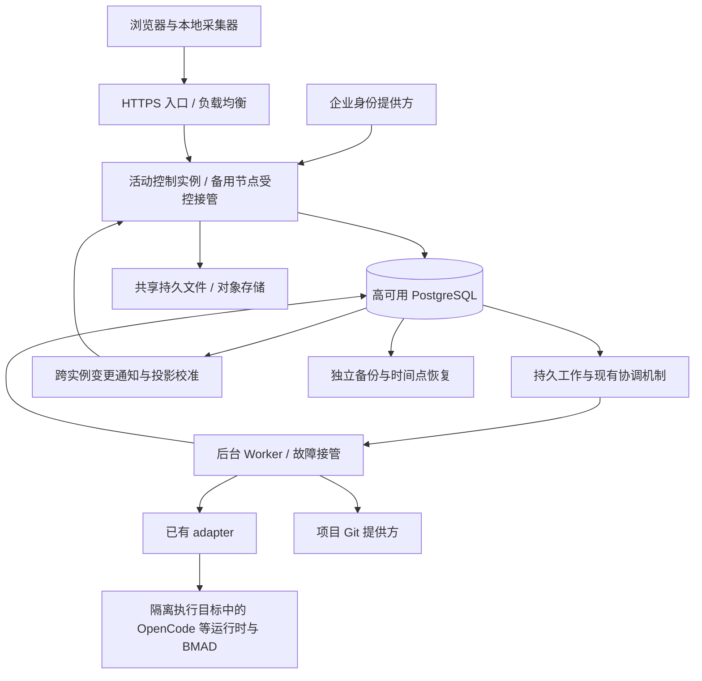

# Comet 开发进度接入与公司级部署方案

> 创建：2026-11-07；修订：2026-11-08，明确集中认证部署、每团队一个 Company、平台运行时位置与执行隔离，并保留任务问答、人工确认和等待 / 恢复的生产验收要求。性质：架构补充与实施验收基线，尚未实现、压测或完成容灾演练。
>
> 2026-11-08 更新规模：**100 个团队、峰值约 200 个或更多实际执行的规划任务**；必须内网自建，已有 Kubernetes / 数据库运维团队。原有 200 项目、500 活跃开发工作区保留为独立测试基线；500 不代表平台规划并发，也不要求平台提供 500 个代码开发容器。部署选择以[内网部署方案](2026-11-08-on-prem-100-teams-deployment.md)为准。
>
> 配套文档：[产品形态](../团队级AI研发平台-产品形态.md)、[技术架构方案](2026-11-05-team-ai-development-architecture.md)。本补充将开发进度采集和公司级质量要求纳入首期正式上线范围；单机 PoC 与具有故障接管能力的单活生产拓扑分别验证。

## 1. 结论与架构调整

平台可以读取 Comet 留在项目中的状态文件，将开发阶段同步到 Paperclip 项目界面。需要增加的是**只读采集、可信来源绑定、状态同步和聚合展示**。代码编写、开发 Agent、调试、测试及详细 Dashboard 继续留在 IDE / 已有 Harness。

开发输入来自平台发布的 BMAD 前期规划文档及候选任务。Paperclip 管理规划 Agent，通过 adapter 调用平台执行环境中的 OpenCode 等运行时，由运行时加载 BMAD 方法包执行规划。用户通过浏览器中的原生任务评论、问题卡片和人工确认参与，无需为规划和审阅在个人电脑安装 CLI 或 BMAD；不建设共享聊天中心。参与本地开发的用户仍在已有 IDE / Harness 环境中，通过自研 Skill 选择任务并生成 Story，再由自研 Workflow 生成开发文档、代码和验证产物；本补充描述进度观察及生产保障，不改变本地开发流程的归属。

原方案的团队、项目、认证和持久记录提供了扩展基础，但不能据此认定已经满足全公司生产要求。公司级上线至少需要落实下表中的增量并通过验收。

| 方面 | 已有设计或核实的基础 | 本次补充 |
| --- | --- | --- |
| 组织范围 | Paperclip Company 映射团队，项目归属团队 | 一个公司部署承载多个团队；企业汇总仍按项目授权过滤 |
| 人机交互 | 原生问题、确认卡片及回答持久投递 | BMAD 检查点与继续执行衔接；必须人工处理时显式 `human_only`，确认绑定文档版本 |
| 本地进度 | Git 交接、结果关联、保留来源与时间 | Comet 状态适配器、只读采集器、认证上报、离线恢复 |
| 状态准确性 | 平台维护交接与人工确认 | 分离本地报告、数据新鲜度、平台阶段和团队验收 |
| 故障接管 | PostgreSQL、现有后台工作协调器和部署通知 | 首期验证单活控制与受控接管；持久工作恢复、浏览器刷新和长期多活分别验收 |
| 数据可靠性 | 文档修订、发布意图、版本确认 | Comet 快照去重及乱序保护、数据库 HA、备份恢复演练 |
| 容量 | 原方案未给出公司级负载模型 | 按 100 团队、200 实际规划 run，叠加 200 项目 / 500 进度来源制定吞吐、延迟、限额与保留策略 |
| 验收 | 原方案已有功能及权限场景 | 增加容量、跨节点、离线、故障、升级和可访问性验收 |

“架构支持”意味着对象、边界和扩展路径明确；“达到质量目标”必须由实现、部署配置和测试结果共同证明。本文属于前者，同时规定后者的验收方式。

## 2. 组织与权限模型

```text
公司级部署 / 企业身份入口
  ├── 团队 A（Paperclip Company / companyId）
  │     ├── 项目 1 → 研发工作 / Case → 多个开发工作区
  │     └── 项目 2
  └── 团队 B（另一个 companyId）
        └── 项目 3
```

采用一套 `authenticated` 模式的集中部署，每团队一个 Company；组织私网配置 `PAPERCLIP_DEPLOYMENT_EXPOSURE=private` 和统一 `PAPERCLIP_PUBLIC_URL`，公网访问使用 `public` 并满足对应检查。这里的“公司”是实际企业，“Company”是 Paperclip 的业务数据作用域和访问控制边界；一套部署可以承载多个 Company，不需要每团队部署一套服务，也不需要为单个企业新增多企业 SaaS 租户层。Company 边界不自动提供文件系统、进程、网络或凭据隔离，这些由第 6.2 节的执行目标配置与验证保障。

- 账号可加入多个团队；SSO 解决登录身份，成员关系和项目权限决定可见内容。
- 默认登录后只返回有权访问的团队及项目。项目私有授权、动作权限、Agent 权限沿用主架构的统一授权边界。
- 跨团队协作通过加入项目所属团队并获得相应项目授权实现；项目保持一个明确的所属团队，避免复制数据或绕过 `companyId`。
- 公司级总览是经授权的聚合视图。负责人需获得明确的组合访问范围；数量、项目名、搜索结果、导出和订阅均可能泄漏信息，必须一并过滤。
- 运维管理员与业务上的全公司项目观察者分开。全局基础设施权限不能作为普通成员读取全部项目的默认途径。
- AI 角色模板可通过现有 company export / import 流程复用；导入后核对未携带的资源、团队凭据、执行目标和方法包，验收后再激活默认暂停的 Agent / routine。模板复用不复制执行授权，执行身份、凭据、上下文和预算仍按团队及项目隔离。[公司导入导出说明](../../cli/README.md#importing--exporting-companies)

鉴权覆盖列表、单资源、附件、搜索、Git 连接、进度源注册、进度读取、实时事件、异步任务和导出。每次收到资源 ID 后，服务端都应校验当前主体是否有权操作该对象；不能把不可猜测的 UUID 当成授权机制。[OWASP 对象级授权要求](https://owasp.org/API-Security/editions/2023/en/0xa1-broken-object-level-authorization/)

## 3. Comet 文件能提供哪些事实

### 3.1 本次核实的范围

核实了本机 `G:/aiProj/comet` 的 Classic 路径，源码 HEAD 为 `08f7140bd8312fd8fb1aa014a2aff7ab7f6deb6e`。这不是对全部 Comet 工作流、已发布版本或用户当前安装包的兼容承诺。正式接入需固定实际版本，并对真实项目样本验证。

| 文件或字段 | 已核实的含义 | 接入限制 |
| --- | --- | --- |
| `openspec/changes/<change>/.comet.yaml` | Classic 变更状态 | `artifact_layout: docs` 时基础目录为 `docs/openspec/changes/`；不能只硬编码一种布局 |
| `<changeDir>/.comet/run-state.json` | 新格式的 Run 状态 | 可能不存在；旧格式曾将 Run 字段放在 YAML 中，需版本化适配 |
| YAML `phase` | `open / design / build / verify / archive` | 是 Comet 阶段，不是平台 BMAD 阶段，也不是整项目百分比 |
| YAML `verify_result`、`verify_failures` | 本地声明的验证状态及失败计数 | 显示为来源报告；平台没有因此重新执行测试 |
| YAML `archived`、`archive_confirmation` | 本地归档及归档确认状态 | 不能替代平台指定人员的验收 |
| YAML `check_epoch` | Classic 转换会增加的检查代际 | 不能当成传输序号；也不能单独证明当前证据有效 |
| JSON `runId / currentStep / status` | 本地 Run 身份、步骤及运行状态 | Run 完成不等于整个变更完成；Run 与 YAML 身份需要一致 |
| YAML 中的计划、设计和验证报告引用 | 提供关联证据的位置 | 路径和内容需校验；不自动读取任意路径或上传全文 |

现有 Comet Dashboard collector 已有发现 Classic 变更和区分工作区的逻辑，可作为适配依据。优先复用经过验证的项目定位、解析和状态投影，不重新发明一套 Comet 流程。

### 3.2 “只读”必须由行为保证

当前 `readClassicState` 先尝试稳定快照；失败时进入 `withClassicStateLock`，后者会调用 `recoverStateTransaction`。即使调用者传入 `{ migrate: false }`，事务恢复仍可能写 Run 状态并删除恢复日志。因此，不能仅凭 `inspectClassicChangeReadOnly` 的名称或禁止迁移选项，就认定整个调用链没有文件副作用。

采集器应使用明确的无写入读取接口或纯解析器：

1. 按允许布局、登记的工作区和文件白名单定位状态；拒绝目录穿越、符号链接 / Windows junction 越界和异常文件类型。
2. 检查写锁、事务日志及文件版本；读取前后核对身份与摘要，确认 YAML 和 Run 关联一致。
3. 发现写入中、恢复中或快照不一致时，有限重试并保留最后一份有效投影，报告“正在同步”或“需要本地处理”。
4. 不创建锁、不迁移格式、不修复文件、不推进 Comet 阶段；恢复操作仍由本地 Comet / Harness 的原有机制负责。
5. 限制文件大小、YAML 复杂度、字段长度和条目数量。新增采集接口必须用目录前后比对及只读挂载验证没有副作用。

在不支持稳定快照的文件系统上，不能宣称双次读取天然提供事务一致性；应使用经验证的 Comet 导出接口，或将该来源标为暂不可采集。具体接口尚需在 Harness 工程中实现或核实。

### 3.3 状态如何呈现

| Comet 报告 | 平台开发摘要示例 |
| --- | --- |
| `open` | 本地正在澄清 / 准备 |
| `design` | 本地方案处理中 |
| `build` | 本地开发中 |
| `verify` | 本地验证中 |
| `archive` 且 `archived = false` | 本地收尾中 |
| `archived = true` | 本地已归档，平台验收状态另行显示 |
| 无法解析或未知版本 | 暂无法读取；保留上次有效信息及时间 |

一个项目可同时有多个 Case、分支和 worktree。界面按对应研发工作展示本地状态，项目摘要只做聚合，不把最新上报的一个工作区当成整个项目的阶段。没有明确任务总数和统计口径时，不显示猜测的完成百分比。

## 4. 文件如何到达平台

### 4.1 三种接入方式

| 工作区位置 | 采集方式 | 能看到什么 |
| --- | --- | --- |
| 开发者电脑，推荐默认 | 在已有 Harness 中增加 / 复用只读采集能力，主动通过 HTTPS 上报 | 已保存到文件的本地状态，包括尚未 push 的状态 |
| 受控远程开发机或挂载目录 | 就近的只读采集进程使用同一协议上报 | 授权挂载范围内的状态；不接受浏览器任意指定服务器文件路径 |
| 仅能访问 Git 远端 | Git webhook 或受控拉取已推送的文件 | 远端提交对应的进度，不具备本地实时性；状态文件若被忽略则无法依赖此路径 |

中央服务器与浏览器不能直接读取员工电脑上的任意目录。Git 拉取也不能看到未提交、未推送或被忽略的文件。首期正式能力采用本地主动上报；Git 和人工关联保留为明确标注的补充来源。

本地采集生命周期应独立于 Dashboard 浏览器页签，避免关闭页面就停止上报；优先挂在已有 Harness 本地服务中。若现有 Harness 没有这一能力，将它作为窄的采集模块补齐，不注册为 Paperclip 开发 Runner。

### 4.2 推荐数据流


采集器使用文件变化监听、约 1 秒合并窗口及最长约 1 秒的发送等待；同时对已登记的活跃目录安排不超过 60 秒的校准扫描，补偿监听遗漏。扫描限范围、限并发，不遍历整个仓库或 `node_modules`。停止观察的来源取消监听和周期任务。

首次接入提供完整当前快照；后续仅在投影变化时发送快照，独立以约 30 秒间隔发送轻量存活信息。收到文件系统事件不立即认定内容变化，需稳定读取和摘要比较。

### 4.3 身份、顺序与恢复契约

下列是拟议协议，并非已有 Harness API。原始文件格式由本地 Comet 适配器解释，平台使用窄的规范化契约。

| 内容 | 约束 |
| --- | --- |
| `schemaVersion / adapterVersion / cometVersion` | 声明协议与解析版本；未知主版本返回明确不支持，不猜测含义 |
| `sourceId / epoch / sequence` | 服务端登记的来源、本次来源代际、持久单调传输序号；重装或丢失序号需要重新登记代际 |
| `repositoryId / worktreeId / branch / headCommit` | 区分同仓库多工作区；分支和 commit 仅作来源上下文，不能单独授予权限 |
| `changeId / runId / handoffId` | 关联变更、可选 Run 和交接；关联关系需由服务端核对，无法映射时留在项目来源列表 |
| `sourceTaskId / localStoryRef`（可选关联） | 关联用户选中的任务与本地生成的 Story；由现有元数据或映射提供，不假设 Comet 原生已有这些字段 |
| `observedAt / stateChangedAt / payloadHash / stateHash` | 采集及内容变化时间、请求摘要及状态内容摘要；服务端另存 `receivedAt`，不按客户端时钟决定先后 |
| `reportedPhase / reportedRunStatus / evidenceSummary` | 保留原始状态及精简证据引用；不包含聊天全文、源代码或本地绝对路径 |
| `collectionStatus / complete` | 区分有效、读取中、无权限、未知格式；采集不完整不能将缺失条目视为删除或完成 |

服务端从来源凭据及登记关系确定 `companyId / projectId`，不信任请求体自报的团队。来源绑定与用户 / 服务身份关联，权限撤销或项目归档后拒绝新的有效写入；允许的诊断和历史读取另行授权。

接收规则：

1. 在一个数据库事务中验证当前来源代际和序号，条件更新最新快照，保存必要的变化事件和通知意图。提交成功后才返回接收确认。
2. 同一 `(sourceId, epoch, sequence)` 的重试必须携带相同摘要；冲突返回 `409`。已过期的序号不覆盖新状态；去重窗口以外的旧消息明确拒绝，不能当成新写入。
3. 新代际激活后，旧代际只允许按历史规则处理，不能更新当前投影。`check_epoch` 保留业务含义，不参与传输排序。
4. 网络中断时使用有界本地持久队列和退避重试。状态快照可合并为每个来源的最新状态；超限时记录丢弃范围，不占满用户磁盘。
5. 重新连接后先恢复来源资格，抖动发送完整快照，再恢复增量；服务端返回已接受序号与投影版本供核对。
6. 工作区、Case 或交接版本改变时显式更新绑定；旧交接的结果不能完成新交接。多个工作区的结果分别保留，由负责人选择验收依据。

快照序号仅控制状态更新；心跳使用独立存活序号，不推进快照序号，也不改写内容或内容变化时间，避免先到的心跳使稍晚到达的快照被丢弃。只有心跳所报告的有效重采样摘要与已接受快照一致时，才能更新该快照的采集健康及重采样时间；新内容必须先提交快照。心跳不进入离线补传队列，重连后重新采样，旧存活消息不得刷新当前健康状态。

文件采集和快照合并保证的是“最终可恢复的当前状态”。它们可能错过两次采样之间的短暂变化，**不承诺完整重放每一次本地事件**。若需要完整执行审计，应对接 Comet 的持久事件源，不能由文件监听推断。

### 4.4 新鲜度与业务事实分离

至少保存并独立展示：平台业务阶段、Comet 报告阶段、来源健康度、最后采集时间、最后收到存活信息时间、最近内容变化时间、交付验收状态。

超过 90 秒没有有效存活信息时，显示“连接中断 / 信息可能过期”。采集器在线但持续读不到有效快照时，显示“采集异常”及上次有效采集时间；不能因为心跳正常就把旧快照视为新鲜。有效重复采集可以更新采集时间，不需要伪造新的内容变化事件。

平台建议显示：“本地验证中 · 5 秒前同步”“最后状态：本地开发中 · 已离线 12 分钟”“本地已归档 · 待团队验收”。故障码、序号和租约等实现细节留在诊断视图。

## 5. 数据模型、接口与模块归属

在主架构四张规划 / 发布表之外，新增以下两个必要业务概念；实施时优先检查现有工作区绑定和事件存储能否承载对应字段，避免平行实体。

| 逻辑记录 | 保存内容 |
| --- | --- |
| `development_progress_sources` | 团队、项目、工作区来源身份、注册主体、凭据引用、当前代际、已接收序号、最后有效快照及哈希、采集 / 存活时间、采集状态 |
| `development_progress_events` | 来源及关联 Case、投影发生的有意义变化、前后版本、时间、精简证据；按时间分区 / 清理，不能无限保存每次心跳 |

快照包含该来源的有界变更列表；授权读取按项目与 Case 过滤。来源凭据在现有凭据设施存储，表里只保存引用或不可逆校验值。删除 / 撤销来源保留必要审计，不能连带删除项目交接或确认历史。

| 拟议接口 | 用途与权限 |
| --- | --- |
| `POST /api/projects/:projectId/development-sources` | 有配置权限的用户登记来源、固定仓库及观察范围，返回短期绑定材料 |
| `POST /api/development-sources/:sourceId/snapshots` | 来源凭据上传规范化当前快照；仅有该来源写权限 |
| `POST /api/development-sources/:sourceId/heartbeat` | 更新存活及采集健康信息；不能推进业务阶段或更改验收 |
| `GET /api/projects/:projectId/development-progress` | 项目权限内读取来源、关联工作和最新投影，支持分页 |
| `DELETE /api/development-sources/:sourceId` | 撤销来源及其后续写权限；保留历史和必要审计 |

本地来源令牌不具备普通 Agent 的执行、读全部文档、改任务或审批能力。按来源限制频率、字节量和有效期，允许单独撤销、轮换；不借用管理员 token。凭据保存在本机受保护存储，连接要求 TLS。

实现归属：Comet 原始格式和布局适配放在 Harness 本地采集模块；规范化协议放在共享契约层；接收、状态聚合放在 `server/src/services/engineering/`；权限与凭据仍由现有模块负责。UI 接入 `ProjectDetail`、任务属性和已有实时刷新机制，保留原生导航与详情方式。该能力不进入开发 Agent 派发链，也不在 `heartbeat.ts` 增加 Comet 流程编排。

## 6. 面向公司级部署的拓扑



这是同一代码库的逻辑职责划分，首期继续模块化单体；图中的后台工作不代表已有可独立部署的 worker 角色开关。集中部署不等于一台机器：按[内网部署方案](2026-11-08-on-prem-100-teams-deployment.md)准备跨故障域的备用资源和接管流程，运行时保持一个完整控制进程。无需因 100 个团队拆成 100 个服务，也不需要先引入 Kafka、独立搜索集群或向量数据库。是否增加长期 API 多活由实测瓶颈和接管验证决定。

### 6.1 API 与实时刷新

- 首期活动控制实例与备用资源位于不同故障域；认证配置、持久状态、密钥和数据库支持接管。旧实例可靠隔离后才启动备用控制进程；就绪、排空和升级流程需验证。API 长期多活不能只通过增加完整 server 副本数开启。
- 实时连接断开后自动重连并重新授权，读取最新投影版本。会话粘滞不能作为正确性的前提。
- 当前核实的 `server/src/services/live-events.ts` 使用进程内 `EventEmitter` 和进程内递增事件 ID。这条路径本身不能提供跨副本广播或重启后的持久重放，不能原样当作公司级通知总线。
- 当前 `deployment-notifications.ts` 已有数据库工作提示与 Company 失效通知，WebSocket 可据此重读授权数据；监听覆盖启动、默认 120 秒接管窗口或持有原生执行期间，明确不是长期水平扩展。复用此入口补齐新进度投影的持久意图与校准；若启用 API 多活，再验证长期监听与缺失通知恢复，不另建重复通知系统。
- 重连、游标过期、通知遗漏或实例启动时，通过授权读取重建视图；存在活跃订阅时安排有界校准。沿用现有调度及空闲机制，不新增全实例永不停止的短周期扫描。
- 不假设自增 ID 分配顺序等于事务提交顺序。投影版本必须有明确的事务顺序；通知可仅携带失效提示并重读最新状态，避免遗漏晚提交事务。

### 6.2 后台工作与规划 Runtime

平台规划运行时由管理员统一准备。以 `opencode_local` 为例，未配置远程目标时，它在 Paperclip server 所在服务器或容器内调用 OpenCode；浏览器用户的电脑不是该“宿主机”。当前标准镜像构建包含 OpenCode 等 CLI，但仍需配置模型、认证、BMAD 方法包和仓库权限。配置受支持的 SSH / 托管沙箱 `executionTarget` 后，CLI 在对应远程环境执行；具体位置和安装责任见[主架构第 11.1 节](2026-11-05-team-ai-development-architecture.md#111-poc-部署与公司级上线边界)。

本地 CLI 执行不会自动获得每 Company 独立的沙箱，共享 Paperclip 容器也不等于团队之间隔离。互不信任团队的规划任务需使用经验证的独立执行目标或 OS / 容器权限边界，限制实际可读写的目录、进程、网络和凭据。SSH 只描述执行传输方式，是否隔离取决于远程环境配置；共享宿主机登录态或全局 provider API key 不能当作团队凭据隔离。执行目标只能访问当前任务获授权的项目资料与模型凭据。

现有 `createDeliveryWorkCoordinator` 提供注册、唤醒、重试和停止机制，可继续使用；其内部也有进程内调度状态，文件本身不是全系统分布式租约正确性的证明。

发布、规划派发和通知等每种后台工作都要具备持久意图、原子领取、租约 / fencing、有限重试及结果核对。先使用经过验证的单活执行所有者加可接管备机；每项工作证明多节点竞争安全后再允许多活消费。不能把所有 API 副本都直接启动成不受约束的全量调度器。

API 负责短事务，模型生成和 Git 网络调用交给后台工作。Comet 接收在短事务完成投影落库后即确认，不把每个快照送给 LLM，也不启动一次规划任务。按团队限制规划并发、预算和队列占用，防止一个团队耗尽全公司资源。

对本地 OpenCode 路径，实际获准执行的 run 会启动运行时及其工具进程；唤醒请求可能被合并、排队或拒绝，不能按“收到一次 heartbeat 就新增一个 Node 进程”估算。应测量整个执行进程树的资源占用，而不只统计 CLI 主进程。远程执行目标分担运行时负载，控制面仍承担调度、日志和状态处理。

| 控制层 | 已核实边界与公司级要求 |
| --- | --- |
| 单 Agent 并发 | 现有派发按 `maxConcurrentRuns - runningCount` 计算槽位；同一 Agent 可按配置并行，唤醒合并不是一律串行的保证 |
| 团队与执行目标总量 | 单 Agent 上限不能推导团队或宿主机总上限；上线前验证所有使用中的派发路径受共同容量约束，缺口在现有准入模块补齐，满额排队且防止单团队长期占满 |
| 运行时资源 | 在实际 OS / 容器 / 沙箱层设置和验证 CPU、内存、进程与磁盘限制；SSH 传输、不同工作目录和 Company ID 均不能替代资源配额 |
| 超时与停止 | OpenCode adapter 的 `timeoutSec=0` 在本地 / SSH 上无 adapter 超时、在托管沙箱上使用 4 小时兜底，负值关闭 adapter 超时；规划任务显式配置正值，并验证 `graceSec` 后进程树释放与远程断连后的状态核对 |
| 唤醒与预算 | 优先事件驱动、必要时启用定时运行；合并重复唤醒、错峰 routine 和预算暂停只能降低负载，不能替代执行目标总量控制 |

本次定向核实了单 Agent 槽位计算与目标超时规则，未证明所有 adapter / Runner 路径具备统一的宿主机容量准入。历史子系统的“分布式 worker 非目标”描述也不能证明当前所有远程或多进程能力不存在；以实际选定版本和执行路径验收为准。

Agent 等待用户时保存方法步骤、输入版本和交互引用，结束本轮执行或通过已验证机制挂起并释放资源，不占用活跃规划执行名额。回答沿用原生持久投递路径；消费时重新检查授权、输入版本、控制版本、暂停 / 结束状态和预算，重复回调不得重复推进。服务重启、跨节点接管及普通任务唤醒都不能绕过待回答或待确认的准入规则，也不能在等待期间反复启动模型。

平台预算治理沿用准入与异步阈值暂停机制；并发和费用迟报可能造成超额，不作为账单精确封顶保证。规划环境按上述要求验证执行隔离；500 个开发工作区仍运行在用户的开发环境中，不需要平台提供 500 个代码开发容器。

### 6.3 数据与文件

生产使用受运维保障的 PostgreSQL HA，跨故障域放置副本并具备故障仲裁、主库隔离和自动接管；PGlite 仅用于本地 / PoC。数据库连接池总额覆盖所有 API 与 worker，不随副本数无限增长。

`DATABASE_POOL_MAX` 控制应用主池，未设置时沿用驱动默认上限 10；它不是可同时登录的人数或可执行 Agent 数。当前数据库客户端还按需创建专用池：租约续期最多 2 条、Runner 检查点最多 3 条、文件存储最多 2 条；独立工作区终结锁操作还可创建单连接客户端。这些上限按拥有相应池的 Db 客户端计算，不能把“主池 + 2”当成整个 server 的固定最大连接数。[数据库客户端](../../packages/db/src/client.ts)

按实际拓扑合计所有 API / worker 的主池与专用池，并计入迁移、监听、独立锁操作、运维与恢复预留；直连预算需低于数据库可用连接额度。使用 pooler 时分别核算客户端连接和 PostgreSQL 后端连接，并验证会话级锁 / 监听等路径的连接模式。`DATABASE_POOL_MAX=25` 仅是调参示例；根据池等待、查询耗时、锁等待和数据库 CPU / I/O 决定是否调整，增大池不能修复慢查询，反而可能增加竞争。

使用池化运行地址时，`DATABASE_MIGRATION_URL` 保持直连；是否启用 `DATABASE_PREPARED_STATEMENTS` 取决于 pooler 的实际支持。断连后的结果可能不确定，不自动重放任意 SQL；只有具备完整幂等性或持久回执的业务操作才可重试，不能用无限数据库重试掩盖过载。[数据库配置与断连语义](../DATABASE.md)

若要求单节点 / 单故障域故障时已确认数据不丢失，应采用经验证的同步持久复制与安全切换，确认必须在数据库满足持久条件后返回。同步副本不可用时不能悄悄降级为异步并继续声称同样的数据保证；通过候选副本和接管保持能力，必要时明确暂停写入。PostgreSQL 默认异步复制可能在主库故障时丢失尚未复制的数据，同步复制也会增加提交等待。[PostgreSQL 同步复制说明](https://www.postgresql.org/docs/current/warm-standby.html#SYNCHRONOUS-REPLICATION)

文档证据、附件及需要恢复的规划产物使用共享持久存储；单个 API 容器的本地磁盘不作为唯一副本。数据库、文件存储、加密密钥和配置都纳入恢复范围。备份独立保留并定期实际恢复；数据库复制不能替代备份。

显式设置 `PAPERCLIP_TOOL_ACTION_SIGNING_SECRET` 时应与 `BETTER_AUTH_SECRET` 独立；未设置时，当前服务从持久化 secrets master key 派生独立签名密钥。同一部署的进程共享有效签名密钥或其来源 master key，并纳入数据库恢复配套；缺失有效密钥会使相关审批 fail-closed，轮换可能使既有审批和重试匹配失效。[Docker 密钥说明](../DOCKER.md)

只读汇总可使用派生表或缓存，权限变更和确认动作从权威存储校验；不能因读副本延迟放行已撤销授权。首期是否需要读副本由压测决定。

## 7. 容量模型与存储控制

以下负载是**设计假设和测试条件**，不是测量结果。用户已确认 100 团队及约 200 个或更多实际执行的规划任务；网页并发人数和历史数据量仍待确定。200 项目 / 500 工作区保留为进度测试基线。

多 Company 数据模型和 FAQ 的“unlimited”不能作为容量承诺。现有局部查询基准也不能替代本产品的混合负载验收；本次没有获得证明“几十到几百人一定够用”或“10 个团队将池设为 25 即可”的测试证据。数据库、控制面、执行目标、对象存储和模型服务限额均可能先成为瓶颈，不预先固定扩容顺序；云服务免费套餐的存储、连接和休眠政策也不作为公司级上线依据。

| 负载项 | 首期验收基线 |
| --- | --- |
| 组织 / 项目 / 活跃来源 | 100 / 200 / 500，包含同项目多分支与多 worktree；后两项为沿用的独立测试基线 |
| 有意义快照变化 | 假设每来源平均 10 秒一次，约 `500 ÷ 10 = 50` 条 / 秒 |
| 存活报告 | 每来源 30 秒一次，约 16.7 条 / 秒；可在快照中合并 |
| 持续接收压测 | 100 条 / 秒，覆盖快照与心跳，持续至少 60 分钟；另做 24 小时稳态观察 |
| 突发与重连 | 500 条 / 秒持续 60 秒；另测 500 来源集中断线与带抖动重连 |
| 消息体 | 典型快照 4 KiB；单次解码后上限 256 KiB，另设字段和条目上限 |
| 网页访问 | 暂以 200 个登录会话 / 实时订阅、合计 100 次列表或详情读取 / 秒压测 |
| 平台规划 | 持续 200 个实际 run，300 个同时到达请求测试超额持久排队与公平调度；等待用户不计入执行名额，另测待处理卡片不引起模型调用或恢复循环；真实模型能力须单独实测 |
| 历史数据 | 以保留周期内的目标事件量预装测试数据；不能只测空数据库 |

规划压测按 20 → 50 → 100 → 200 实际 run 逐级增加，叠加网页读写、答案提交、Comet 接收和跨团队突发，另测单目标满额、模型限流、超时及目标失联。记录执行进程树的 CPU、峰值内存和 I/O、控制面事件循环延迟、排队时长、池等待、锁等待和接口 p95 / p99；按实测瓶颈扩执行目标、调优查询 / 连接池。运行数量超过 200 的持续能力需要提高容量后重新验收，不能把排队能力当同时执行能力。接管与多副本均需实测，不能仅凭共享数据库和签名密钥认定水平扩展完成。

4 KiB 快照在 50 条 / 秒时约 200 KiB / 秒；在 500 条 / 秒时约 1.95 MiB / 秒，均不含协议、索引和复制开销。但若每条都永久留存，50 条 / 秒将产生 **432 万条 / 天、约 17.7 GB / 天的原始内容**。因此，吞吐之外还必须控制历史保存量。

- 当前快照按来源覆盖更新；心跳只更新存活及采集信息，不逐条写审计历史。
- 只对阶段、验证状态、绑定、阻塞和关键结果变化保存精简语义事件。纯采集时间变化不创建业务事件。
- 语义事件暂以 90 天在线保留为设计起点，超期按企业档案策略归档 / 清理；交接、确认和已接受成果不随短期进度事件一起清理。原始诊断内容默认不保存。
- 若语义变化本身也达到 50 条 / 秒，应按每天 432 万条评估分区、存储及保留成本；不能假设合并一定会显著降量。
- 同时按来源、团队和全局限制请求数与解码后字节数。典型 4 KiB 突发目标不意味着承诺同速接受所有 256 KiB 大包；大包混合负载需单独验收。
- 遇到限流返回明确的 `429` 和重试建议；来源本地合并快照并退避。达到存储 / 队列水位时拒绝新接收或延后，不能先返回成功再丢弃。
- 复合索引以团队、项目、来源和时间为查询边界；默认分页，不按每个来源独立查询造成 N+1。公司汇总按授权范围批量查询投影，不遍历员工电脑。

除 Comet 进度外，还需测量任务评论、文档修订正文、运行事件和费用记录的增长，以及索引、WAL、复制和备份占用；附件 / 对象存储另计。保留策略须保护确认版本、交接和审计证据，不能为控制空间直接清理仍被引用的修订。需要定位数据库负载时可使用 `PAPERCLIP_DB_RESPONSE_CAPTURE_WINDOW` 的最长 60 秒有界诊断窗口，并遵守当前诊断的采样与计时边界；诊断输出不等于数据库纯执行耗时或完整网络字节量。[数据库诊断](../DATABASE.md#bounded-response-diagnostics)

此规模值得先用单个 HA PostgreSQL 集群验证。是否分库、增加消息中间件或独立进度接收部署由实测瓶颈决定，现阶段不预先承诺机器规格。

## 8. 质量属性与可测量目标

下表全部为**建议验收目标**，并非现有系统指标或已签署 SLA。统一记录版本、硬件、数据库拓扑、数据量、消息大小和负载，避免不同条件下的数字混用。

| 属性 | 机制 | 建议验收目标及证据 |
| --- | --- | --- |
| 高可用性 | 单活控制与受控接管、数据库 HA、隔离执行池、持久存储 | 核心读写与进度接收分别以月可用性 99.9% 为目标；按本轮内网部署方案，以控制服务恢复不超过 3 分钟、数据库安全切换不超过 60 秒作为试验目标；任务续接单独测量，替换原先未验证的 API 60 秒 / 工作 120 秒假设 |
| 可靠性 | 持久确认、幂等、序号及代际、事务 outbox、Git 结果核对 | 重复、乱序、响应丢失不产生重复业务结果或旧状态覆盖；数据库确认前故障返回不确定并可安全重试 |
| 人机交互正确性 | 人工解析策略、指定接收人、精确文档版本、持久检查点 | Agent 自行批准及未授权代答被拒绝；等待中重启可恢复，重复回答不重复推进，过期确认不能批准新版本 |
| 数据恢复 | 同步复制、故障仲裁、备份及时间点恢复 | 在验证过的单节点 / 单故障域故障模型下，已确认核心数据 RPO = 0；整体灾难恢复暂定 RPO ≤ 5 分钟、RTO ≤ 60 分钟，通过独立恢复演练证明 |
| 进度时效 | 本地监听、合并、上报、跨节点刷新 | 来源在线且文件有效、网络正常、负载符合第 7 节时，文件稳定保存到可见状态 p95 ≤ 5 秒、p99 ≤ 15 秒；监听遗漏的校准目标 ≤ 60 秒加传输时间 |
| 接口性能 | 小事务、索引、分页、批量查询、限额 | 第 7 节负载下，普通列表 / 详情 p95 ≤ 500 毫秒；接收持久确认 p95 ≤ 500 毫秒、p99 ≤ 1 秒；大包及限流流量单独报告 |
| 安全性 | 统一认证、对象授权、来源最小权限、凭据隔离 | 隔离矩阵中跨团队 / 项目访问全部拒绝；权限撤销后新请求立即按权威权限判断，缓存 / 活跃订阅最长 60 秒内失效 |
| 可测试性 | 纯解析、协议契约、可控时钟、故障注入、真实集成 | 两种目录布局、实际支持版本、写入竞态、断网、重启、重复及乱序都有确定性场景；只读采集不改变任何项目文件 |
| 可交互性与可访问性 | 沿用原生页、问题与确认卡片、可恢复输入、键盘操作 | 问答、拒绝 / 修改、版本确认及断线恢复均可解释；键盘完成主要流程，读屏能识别状态更新，信息不只靠颜色 |
| 互操作性 | 版本化协议、Comet 适配、固定 Git 来源 | 支持版本具备真实文件契约测试；未知版本不误判完成；升级期间新旧受支持客户端均可上报 |
| 可维护性 / 可部署性 | 模块归属清晰、兼容迁移、分阶段启用 | 采集功能可独立关闭而历史可读；受控排空与接管升级保留数据并支持会话重连；回滚不删除用户文档或状态 |
| 可观测性 | 指标、关联日志、可选 trace、来源健康 | 能定位接收失败、状态延迟、过期比例、队列积压、数据库切换和授权拒绝；日志默认不包含代码、密钥或完整本地路径 |
| 资源公平性 | 团队配额、独立规划并发、字节限流 | 单团队突发 / 模型超时不饿死其他团队；在约定负载内其他团队仍满足核心接口目标 |

可用性按有效请求的服务成功率统计，计划内维护造成的失败也计入；同时监测用户关键旅程。内部数据库或共享存储故障不能被排除出核心服务指标。客户端真正离线时不承诺文件到平台时效，但应计入来源离线指标，不能伪装为正常实时数据。

AI 生成时间、Git 提供方可用性、企业登录提供方和端到端规划完成率单独监测。模型故障时，已保存的项目、文档和进度仍可读取；平台不能用“任务已接收”的成功率代替实际成果完成率。登录依赖故障应在登录旅程中真实反映。

用户思考与回答时间单独统计，不计为模型超时；卡片读取、答案持久接收和回答后的恢复派发仍属于平台服务。不能用“正在等待用户”掩盖交互丢失或投递故障。恢复排队时间与实际模型执行时间分开记录。

进度数据和业务审计留在本实例的数据路径，不默认作为第一方 Telemetry 上报。若配置 OpenTelemetry，继续遵循操作方显式配置端点及字段白名单；本地详细运行日志仍留在 Harness。

RPO 表示允许丢失多新的数据，RTO 表示恢复业务所需时间。整体灾难下尚未同步或备份的数据、本地尚未成功上报的文件，不属于单故障已确认数据 RPO = 0 的承诺范围。确认、权限、交接和成果证据的恢复不能依赖员工电脑重新上报。

## 9. 失败处理与验收场景

| 场景 | 预期行为 |
| --- | --- |
| 文件正在写、锁 / 日志存在 | 不读出伪快照，不修复本地文件；有限重试，保留上次有效信息 |
| YAML 损坏或未来格式 | 显示采集异常 / 不支持；其他来源继续工作，不把缺失解释为完成 |
| 同项目两个 worktree 同名变更 | 按来源独立呈现，映射到明确 Case；不按变更名或仓库 URL 覆盖 |
| 离线、电脑休眠、短暂断网 | 本地开发照常；平台显示过期；恢复后有限补传并收敛到当前快照 |
| 状态从验证退回开发 | 接受新序号的真实阶段回退；不假设阶段单调递增 |
| 新代际后收到旧消息 | 旧消息不能覆盖当前快照，保留可诊断原因 |
| 接收提交成功但响应丢失 | 重试得到同一已接受结果，不重复追加语义变化 |
| API A 接收、浏览器连 API B | B 能收到刷新或在校准窗口内恢复最新投影；重连不丢当前状态 |
| worker 持有旧租约后恢复 | 旧所有者不能覆盖新结果；外部 Git 副作用仍按主架构专属 ref 与候选 commit 核对 |
| 等待回答时服务重启或切换节点 | 问题、输入版本和检查点保留；不重复提问、不空转模型，有效回答后从正确步骤继续 |
| 回答重复提交或继续事件重投 | 记录一致，当前回答版本只消费一次；暂停 / 结束的工作不被历史回答重新启动 |
| Agent 自行批准或他人代答 | `human_only`、指定接收人和当前项目授权共同生效；普通评论不接受确认卡片 |
| 文档修改后提交旧确认 | 提示版本已变化，保留历史；重新审阅当前候选，旧批准不推进新阶段 |
| 主数据库切换 | 不把未持久请求当成功；客户端可重试，已确认核心数据满足约定故障模型 |
| 成员撤权、来源被撤销 | 新上报 / 查询受阻，活动订阅关闭或过滤；不声称已撤回本地克隆文件 |
| 单团队暴增 / LLM 不可用 | 按配额排队或限流，其他团队读取和进度接收保持独立 |
| 跨 Agent 同时唤醒 / 执行目标满额 | 按目标与团队容量排队，不因单 Agent 尚有槽位就超额启动；等待中的人工交互不占执行名额 |
| CLI 超时 / SSH 断连 / 沙箱失联 | 核对进程是否实际终止、资源与租约是否释放；状态不明时不盲目重启重放副作用 |
| 数据库连接预算接近上限 | 主池与专用连接均有统计，受控降载后交互和必要续租仍可完成；增大池或增加副本不绕过数据库连接总预算 |
| 备份损坏 / 对象缺失 | 恢复演练失败并阻止宣称达标，核对文档、确认、权限与附件的一致性 |
| 关闭进度功能 | 停止新采集和上报，保留历史及交接；手动关联交付仍可使用 |

测试分层：纯解析及映射单测；真实 PostgreSQL 的接收 / 并发 / 授权测试；选定 Runtime 的 BMAD 提问、人工确认与恢复；真实 Comet 项目的只读与契约测试；浏览器跨节点恢复；容量压测及故障演练。模拟器用于制造大量来源和确定性失败，不能代替真实的 BMAD → 用户问答与确认闭环，以及至少一条 Harness → Comet 文件 → 平台项目页的验证。

## 10. 实施顺序与上线门槛

1. **固定契约。** 取真实项目及当前安装版本，确认两种布局、并行 worktree、状态与证据字段。选择纯只读接口，完成来源绑定和最小规范化快照契约。
2. **做通一个来源。** 在现有 Harness 中接采集，完成权限注册、状态接收、项目原生展示和断线恢复；验证不写项目文件、不触发平台开发 run。
3. **完成交接与验收闭环。** 多来源关联 Case / 交接，接入交付结果与团队验收；保留本地报告和人工确认的独立状态。
4. **完成生产基础。** 验证单活控制面受控接管、数据库 HA、执行目标与持久文件、密钥及备份；验证部署通知、停止和恢复，未经验证不使用双控制器滚动重叠。
5. **验证规模。** 用 100 团队 / 200 项目 / 500 来源叠加 200 实际规划 run 执行第 7～9 节及内网部署方案的场景，记录目标、实测、偏差及修复。
6. **分批开放。** 少量团队试用后逐步扩大到目标规模。权限隔离、只读保证、已确认数据恢复、重试正确性未通过时，不进入全公司正式发布。

主架构阶段 A / B 先用一个产品经理 Agent、一种 Runtime 和一条 BMAD 规划 Workflow 验证提问、等待、回答、PRD、版本确认、继续执行及 Git 交接；无需先建设共享聊天。进度闭环与生产可靠性按上述顺序准备。公司级正式上线以此处门槛为准，不把 PoC 单实例成功当成 500 工作区验收。

## 11. 证据与尚未核实的部分

本次为定向源码核实，未做全仓库高可用或安全审计。Paperclip HEAD 为 `3d3485478d6ea1e80c0b329f4423cd2df818b855`；进度生产基础依据事件发布与后台协调路径的读取。人机交互依据同一 HEAD 的原生问题、确认服务及卡片读取，核实范围和索引代际见主架构第 15 节；BMAD 端到端恢复尚未实测。其他复用结论仍以主架构注明的基线为准。

2026-11-08 在同一 HEAD 补查数据库专用池、单 Agent 派发槽位及执行目标超时。图索引为 `2026-11-07T12:42:32Z`，相关路径存在元数据变化、局部解析缺口或排除项，结论以当前直接源码读取为准；没有据此推断全仓不存在其他容量控制，也没有运行组织级压力测试。

| 依据 | 用途 |
| --- | --- |
| Comet `domains/comet-classic/classic-state.ts`、`classic-layout.ts` | 阶段、字段与布局 |
| Comet `domains/engine/state.ts` | `.comet/run-state.json` 及 Run 字段 |
| Comet `classic-store.ts`、`classic-diagnostics.ts`、`classic-transitions.ts` | 读取 / 恢复边界、诊断调用链及检查代际 |
| Comet `domains/dashboard/collector.ts` | 已有变更与工作区发现逻辑，作为适配依据 |
| [Paperclip 实时事件](../../server/src/services/live-events.ts) | 进程内 emitter 与事件 ID 的边界 |
| [部署通知](../../server/src/services/deployment-notifications.ts)、[WebSocket 接入](../../server/src/realtime/live-events-ws.ts) | 已有部署接管期间的跨进程失效通知；不等于长期多活通知保证 |
| [Paperclip 后台协调器](../../server/src/services/delivery-work-coordinator.ts) | 可复用唤醒、重试、停止机制，不等于完整分布式正确性证明 |
| [部署模式](../DEPLOYMENT-MODES.md)、[Docker 部署](../DOCKER.md)、[Agent 运行说明](../../docs/agents-runtime.md)、[Adapter 执行目标](../../docs/adapters/overview.md) | 集中认证部署、CLI 与凭据位置、远程目标和执行隔离边界；配置细节见主架构 |
| [数据库客户端](../../packages/db/src/client.ts)、[数据库配置与诊断](../DATABASE.md) | 主池与按需专用池、连接调优、断连重试边界和诊断限制 |
| [Agent 派发队列](../../server/src/services/heartbeat/queue.ts)、[Heartbeat 策略](../../server/src/services/heartbeat/timer-policy.ts)、[执行目标](../../packages/adapter-utils/src/execution-target.ts) | 单 Agent 并发槽位、目标超时默认值；不构成全局容量或性能证明 |
| [Paperclip 交互服务](../../server/src/services/issue-thread-interactions.ts)、[原生卡片](../../ui/src/components/IssueThreadInteractionCard.tsx) | 问题、人工解析策略、版本 target 和回答持久投递；方法检查点衔接仍需实现验证 |
| [OWASP 对象级授权](https://owasp.org/API-Security/editions/2023/en/0xa1-broken-object-level-authorization/) | 每次资源访问的授权要求 |
| [PostgreSQL 同步复制](https://www.postgresql.org/docs/current/warm-standby.html#SYNCHRONOUS-REPLICATION) | 同步 / 异步复制的数据保证与可用性取舍 |

图索引基代：Comet `2026-10-07T12:42:06Z`、Paperclip `2026-11-05T16:01:03Z`。引用路径的覆盖报告标记 `metadata_changed`，因此关键结论使用当前直接源码读取确认，没有把图的无缺口记录当作完整性证明。

用户已确认内网 Kubernetes / 数据库运维基础及 200+ 规划并发。尚需核实 Harness 的采集入口和安装版本、身份提供方、物理故障域、备份与模型容量及保留要求。本次没有运行应用、采集器、压力测试或故障演练；文中的容量、性能和恢复数字均是待验证目标。
