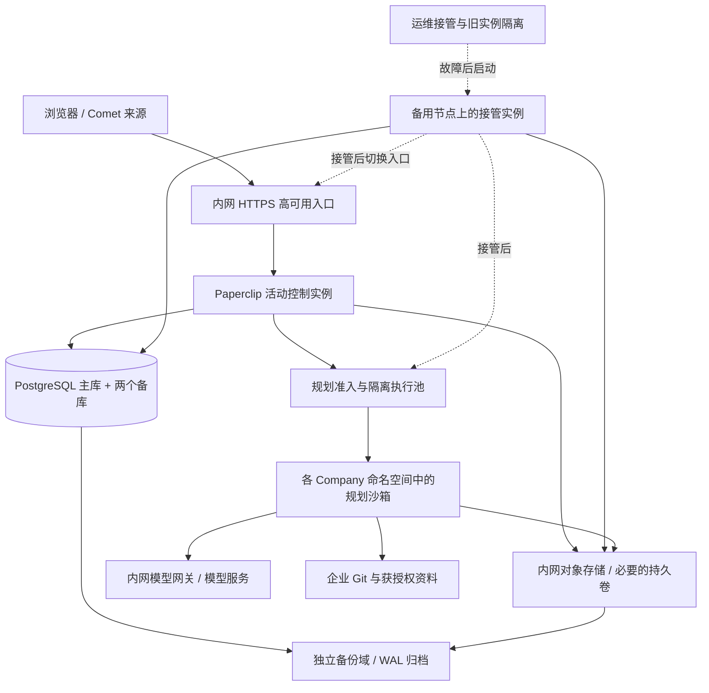

# 100 团队、200+ 规划并发的内网部署与验收方案

> **历史扩容场景，已不作为当前实施或采购基线。** 用户在后续评审明确改为 20 团队、50 项目、50 实际并发 Run；当前范围见[总结与风险](../enterprise_ai_rd_platform_summary_and_risks.md)，工程顺序见[BMAD 接入计划](2026-11-08-bmad-integration-and-delivery-plan.md)。以下保留旧规模的推导和技术边界供扩容时参考，所有 100 / 200 / 300 数值均属于历史场景；500 工作区也仅保留为待确认压力假设。

> 2026-11-08。用户已确认：100 个团队，峰值约 200 个或更多正在执行的规划任务，必须内网自建，已有 Kubernetes 与数据库运维团队。本文是建议方案和上线门槛，未部署、未压测，不是容量或可用性证明。
>
> 产品边界沿用[产品形态](../团队级AI研发平台-产品形态.md)和[主架构](2026-11-05-team-ai-development-architecture.md)：平台执行 BMAD 前期规划；代码开发留在用户 IDE / Harness。200 指正在执行的规划任务，不含等待用户的任务；一次任务若并行启动多个 run，容量按全部实际 run 计算。原有 200 项目、500 活跃开发工作区保留为独立测试基线，不随团队数自动翻倍。

## 1. 决策

采用一套逻辑平台、每团队一个 Company，分离控制平面、HA PostgreSQL、规划执行池和持久存储。优先复用现有模块与运维设施，不要求自己开发 Agent 引擎。

首期采用**单活控制平面、受控故障接管、多个隔离执行目标**。单活指同一时刻只有一个完整 Paperclip 控制进程承担入口与后台职责，基础设施和数据不放在单台机器上。为备用节点预留资源、镜像和配置；旧实例被可靠隔离后才启动接管实例。备用应用不作为第二个常驻全功能调度器运行。这是待验证的自建部署策略，不是 Paperclip 已提供的一键 HA 模式。

先验证一个活动控制进程能否承受 200 个远程 run 与混合业务负载。通过则保持此拓扑；未通过时根据事件循环、数据库、日志和模型限额定位原因。只有证据指向控制面吞吐时，才扩展 API 多活或按 Company 拆分部署。多活上线前还需逐项验证后台领取、续租、通知和恢复；不能直接把完整 server 的副本数改成 3。高可用可以通过安全主备实现，不要求首期拆出另一套微服务。

“200 或更多”没有有限上界。第一阶段验证持续 200 个实际 run，300 个同时到达请求作为突发试验，超出已认证执行容量的请求持久排队。若业务要求 300 个也同时运行，应把持续容量和故障后剩余容量一并提升到 300 后重新验收。

## 2. 当前实现能够证明什么

核验基线：工作树 HEAD `3d3485478d6ea1e80c0b329f4423cd2df818b855`。这是定向源码与文档核实，不是完整 HA 审计。

沿用图索引代际 `2026-11-07T12:42:32Z` 的发现路径，覆盖报告提示文件元数据变化后直接读取源码；后续部署通知补查时图服务不可用，使用当前文件与调用处核对，不将图结果作为完整性证明。

| 依据 | 已有能力 | 不能据此承诺的事情 |
| --- | --- | --- |
| [部署通知](../../server/src/services/deployment-notifications.ts)、[WebSocket 接入](../../server/src/realtime/live-events-ws.ts) | 通过数据库传递工作提示和 Company 失效通知，客户端重新读取授权数据；监听覆盖启动、默认 120 秒接管窗口或仍持有原生执行期间 | 注释明确排除长期水平扩展；纯浏览器连接不会持续保活数据库监听。不是完整的长期多活通知保证 |
| [Cloud standby](../../server/src/services/cloud-warm-standby.ts) | 特定 Cloud 未认领空实例可以等待激活 | `PAPERCLIP_CLOUD_WARM_STANDBY` 不是已有自建实例的通用主备开关 |
| [原生控制器恢复设计](2026-10-30-native-controller-checkpoints.md)、[连续性测试](../testing-native-remote-continuity.md) | 原生 Runner 的租约、加密检查点与恢复已有实现和限定范围的验证 | 依赖支持的远程 Runner、持久密钥及仍存活的执行环境；不能直接推广为 OpenCode + Kubernetes Pod 丢失后透明续跑 |
| [控制器性能证据](2026-10-30-native-controller-qualification-evidence.json) | 仓库有组件级测量，不能概括为完全没有压测 | 不是本产品 100 团队、200 个真实模型任务、HTTP、WebSocket 和节点切换的整体验收 |
| [Kubernetes 插件](../../packages/plugins/sandbox-providers/kubernetes/README.md) | 已有第一方执行目标插件、按团队命名空间、配额及安全配置 | 当前为 alpha；默认 `sandbox-cr` 依赖 alpha CRD。`job` 后端不支持相同的多命令 exec / adapter 安装流程，不能直接替换 |
| [沙箱构建](../../packages/plugins/sandbox-providers/kubernetes/src/sandbox-cr-builder.ts) | 构建受限容器与独立工作目录 | 默认工作区等使用 `emptyDir`；Pod 删除后不能假定未同步文件和会话还在。附件使用 S3 也不会自动持久化运行时工作区 |

因此，首个放行条件是固定一条实际生产组合：Paperclip commit / 镜像、Kubernetes 插件与 CRD、OpenCode 或 Runner、模型、BMAD、工作区持久策略。不能拿另一种 provider 或仍存活沙箱的测试替这条组合背书。

## 3. 部署拓扑



- Kubernetes 使用现有受运维支持的版本，控制节点、存储及执行节点覆盖独立物理故障域；多个虚拟机位于同一宿主机不算多个故障域。控制服务和执行池使用不同节点池 / 调度约束，避免执行任务耗尽控制面资源。
- 入口、企业身份系统、内网 DNS、镜像仓库、模型网关、Git 和对象存储纳入依赖清单；关键单点故障必须有降级或恢复目标。模型生成期间不能持有长数据库事务。
- 基础配置采用 `authenticated`、`PAPERCLIP_DEPLOYMENT_EXPOSURE=private` 和统一 `PAPERCLIP_PUBLIC_URL`；CLI 与 BMAD 在执行镜像中固定版本，镜像按 digest 从内网仓库分发。不依赖任务启动时访问公网下载安装脚本。
- 普通浏览器用户无需安装 OpenCode。CLI 在实际执行目标中运行，回调访问统一入口，不绑定某个控制 Pod IP。凭据按任务授权注入，避免把管理员全局 provider key 复制给所有团队。

### 3.1 控制平面接管

接管顺序：探测故障 → 停止新派发 → 确认并隔离旧控制实例 → 确认数据库主库与密钥可用 → 启动备用控制实例并完成恢复 → readiness 通过 → 切换入口 → 浏览器重连、任务核对和恢复。

隔离必须覆盖旧进程的数据库访问及执行控制权限。仅摘除 Service endpoint 或删除 Kubernetes API 中的 Pod 对象，不能证明网络分区另一端的旧进程已停止。运维采用已有的主机 fencing / 断电或等效强制隔离机制；无法证明旧实例失去副作用能力时，停止自动接管，显式降级处理。所有权 token 只保护实际校验它的路径，不能代替对 Git 等外部写入的幂等核对。

使用单活工作负载策略，避免普通滚动升级的 surge 同时启动两个完整控制器；升级按排空、保存、停旧、起新和恢复执行。已有原生临时重叠机制只有在所选组合通过验证后才启用。扩容或升级都不能自行创建第二个调度所有者。

故障探测、节点隔离、驱逐、镜像启动和应用恢复的总耗时必须满足接管目标；不能假定 Kubernetes 默认重调度时间即可达到 3 分钟。预留容量和预拉取镜像也不能替代旧节点的可靠隔离。

Readiness 检查启动恢复和必要依赖；liveness 不应因模型服务暂时不可用而重启整个控制服务。任务停止和恢复复用已有机制，验证其实际对所选 adapter 有效。控制面恢复可用与某个运行透明续跑是两项指标。

### 3.2 PostgreSQL 与备份

复用运维团队已维护的 PostgreSQL HA 方案，采用一个主库和两个备库，跨故障域部署，配套仲裁、旧主隔离和高可用连接入口。没有既有方案时再评估 Patroni 或成熟 PostgreSQL Operator，不为本平台并行引入两套数据库运维体系。

已确认的核心记录若要求单故障下 RPO 为 0，应使用满足该故障模型的同步持久提交、同步备库选择和受控切换；没有合格同步副本时暂停相关写入，不能静默降为异步后继续声称零损失。该目标限定于已经按持久条件确认的提交；连接中断或提交等待被取消时，结果仍可能不确定，必须通过操作 ID 核对。[PostgreSQL 复制](https://www.postgresql.org/docs/current/warm-standby.html)、[故障隔离](https://www.postgresql.org/docs/current/warm-standby-failover.html)、[Patroni 同步模式](https://patroni.readthedocs.io/en/latest/replication_modes.html)

应用优先通过主库直连或经过验证的 session pool 接入。`DATABASE_POOL_MAX` 从默认 10 起测，证据表明需要时再提高到 20 / 25 等值。连接预算包含每个拥有连接池的 Db 客户端的主池、按需租约池 2、检查点池 3、文件池 2、独立工作区锁、监听、迁移、运维和恢复余量；不要只按“主池 + 2”估算。使用 pooler 时区分客户端与数据库后端连接预算。[数据库客户端](../../packages/db/src/client.ts)

事务池不能直接替代会话级 `LISTEN` 和 advisory lock 连接；保留相应直连 / session 通道，仅设置迁移直连不足以证明所有运行时路径兼容。权限、确认和任务控制读取主库，不靠可能滞后的只读副本作授权决定。[PgBouncer 功能兼容表](https://www.pgbouncer.org/features.html)

基础备份与连续 WAL 归档写入独立备份域，定期从备份重建数据库；对象存储另有版本 / 备份与恢复演练。持久 secrets master key、认证配置及工具审批签名密钥按恢复批次保管。主备复制不是备份，缺失密钥的数据库备份也不构成完整恢复。[PostgreSQL PITR](https://www.postgresql.org/docs/current/continuous-archiving.html)

### 3.3 执行隔离、准入与持久性

每团队一个命名空间，分别限制实际 CPU、内存、临时磁盘、Pod 和进程数量，设置最小 RBAC 和网络访问；敏感或互不信任工作负载另评估经过验证的隔离 runtime / 专用节点。Company ID、namespace 名称或 SSH 连接本身均不提供完整隔离。[Kubernetes 多租户边界](https://kubernetes.io/docs/concepts/security/multi-tenancy/)

复用 Kubernetes 插件前，核验以下具体边界：

- 插件当前团队默认配额为代码中的固定配置；既有 ResourceQuota / LimitRange 可由运维预先准备并验证。不要假定文档中的任意数字都是可直接设置的插件字段。[团队资源创建](../../packages/plugins/sandbox-providers/kubernetes/src/tenant-orchestrator.ts)
- `standard` 网络策略对 FQDN 的处理可能允许较宽的公网 HTTP(S) 出站；内网方案显式放行所需 CIDR，或使用已验证的 Cilium FQDN 策略，并测试其他团队、数据库、云元数据端点及 Kubernetes API 的拒绝规则。回调 namespace 和端口以实际插件配置 / 源码为准。[插件实现](../../packages/plugins/sandbox-providers/kubernetes/src/plugin.ts)
- 检查实际注入的每个凭据和挂载。模板导入、命名空间与 Secret 对象存在，不代表凭据授权范围已经正确。
- 工作区恢复选择经过验证的持久卷，或按步骤同步到持久存储并保存不可变检查点。更换默认 `emptyDir` 需要插件支持与恢复测试，不能只通过外围部署配置声称已解决。共享卷还需验证挂载、旧写者隔离和故障域可达性。
- 区分“控制进程退出但沙箱仍活着”和“沙箱 Pod / 节点永久丢失”。后者可以从业务检查点恢复或重做安全步骤，但不得盲目重放已发生的 Git、审批或工具副作用。

准入复用现有队列和调度模块，验证所有生产派发入口都执行全局、Company、执行目标和模型限额。容量不足时持久排队，排队任务不提前占满沙箱；一旦申请 Pod 要计算在途和保留容量。按团队公平分配，允许借用空闲容量，禁止某个团队长期占满。等待用户的任务保存状态并释放执行槽位；仍保留的工作区 / 空闲 Pod 另计资源。

单 Agent 可先设 `max concurrent runs=1` 作为试点策略；它不能替代上述总量准入。配置明确的正值 `timeoutSec`、停止宽限期并测量进程树退出。预算只能约束已报告费用和后续准入，不能替代资源上限或保证账单绝不超额。

## 4. 容量计算与试验起点

下表是压测环境的资源起点，不是采购清单或已证明的容量。控制面与数据库的规格需在 200 个真实 run、日志回传、网页读写和 Comet 进度混合负载下调整。

| 层 | 初始试验预算 | 观察依据 |
| --- | --- | --- |
| 活动控制面 | 8 vCPU / 16 GiB；备用节点保留同等可用资源 | 事件循环延迟、RSS、GC、API p95 / p99、日志处理和恢复时间；单 Node 主线程不会因多核而线性扩展 |
| PostgreSQL | 3 个节点，各 8 vCPU / 32 GiB，低延迟持久盘 | 池等待、慢查询、锁、WAL、复制延迟、备份和历史数据规模；容量以主库为准，不把三副本资源相加 |
| 单规划 run | 先用 2 vCPU / 4 GiB 作为隔离和容量试验档位 | 测量 CLI 及全部工具子进程的峰值；OOM、并行工具、文档规模和挂载开销均可能要求增加 |
| 执行节点 | 根据下式及实测决定数量 | 受 CPU、内存、临时磁盘、网络、IP / Pod 数量和模型限额共同约束 |

```text
节点槽位 = floor(min(可分配 CPU / 单 run CPU 预算,
                      可分配内存 / 单 run 内存预算,
                      磁盘、Pod 数和其他约束折算槽位))

故障后可用槽位 = 总槽位 - 最大约定故障域中的槽位
上线要求：故障后可用槽位 >= 目标同时执行 run 数
```

举例：32 vCPU / 128 GiB 节点扣除系统和预留后，假设可给执行任务 24 vCPU / 96 GiB；按每 run 2 vCPU / 4 GiB，CPU 限制为 12 个槽位。18 台在损失一台后剩 204 槽位；若要求丢失三个等规模故障域中的任意一个后仍能运行 200 个，27 台按 9 / 9 / 9 分布，故障后剩 216 槽位。此例只说明 N+1 与整故障域容错的差异，不证明需要购买 18 或 27 台机器；其他约束可能降低槽位，实测轻负载也可能减少资源需求。

Kubernetes 按 requests 调度，低 requests 配合较高 limits 不会自动为 200 个任务保留峰值内存；内存达到限制可能 OOM，CPU 限制可能导致节流。资源预算应与选定 SLO 一起测量，不能只看节点平均使用率。[资源管理语义](https://kubernetes.io/docs/concepts/configuration/manage-resources-containers/)

同时核验模型服务：实际 RPM、输入 / 输出 TPM、工具轮次、上下文大小、并行上限与首 token 延迟。若平均每个 run 每分钟发起 r 次请求，总量至少按 `200 × r` 请求 / 分钟估算，再验证 token 和突发限制。模型内网自托管时 GPU 推理容量另算；上述 CPU 节点不包含模型推理集群。

## 5. 上线验收与运维

以下是建议的验收目标，需要在目标基础设施中实测通过后才可对用户承诺。控制面可用性先以月度 99.9% 为规划目标，不将一次 24 小时测试等同于月度 SLA。

| 验收 | 初始目标 / 必须满足的行为 |
| --- | --- |
| 稳态混合负载 | 100 Company、持续 200 实际 run，加原 200 项目 / 500 Comet 来源基线与网页访问；持续至少 24 小时，覆盖历史数据和日志增长 |
| 突发 | 300 个同时到达的规划请求；超出认证容量部分持久排队，未丢失、未重复启动，其他团队有公平进展 |
| 交互性能 | 典型列表 / 详情 / 答案提交 p95 < 500 ms、p99 < 1 s；模型生成和大文件传输单列，不混为短 API 指标；已接纳请求服务端错误率 < 0.1% |
| 排队与刷新 | 已有容量时从获准派发到执行就绪 p95 < 30 s，冷启动另测；状态刷新 p95 < 5 s；满额等待显示排队原因，不能用排队隐藏执行性能 |
| 控制面故障 | 测真实节点断电、网络分区及进程退出；建议服务恢复 RTO <= 3 分钟，旧所有者不能产生迟到副作用；运行续接 / 安全重试时间另记 |
| 数据库故障 | 建议安全主备切换 RTO <= 60 秒；已按同步持久条件确认的核心提交在约定单故障模型下不丢失；不确定提交可核对 |
| 执行故障 | 单节点失效后有足够剩余容量；若承诺整故障域容错，也演练整域失联。Pod 丢失时能恢复持久产物和正确状态，不能报告虚假成功 |
| 人工交互 | 等待用户不占运行槽位；故障接管、重投回答、重复确认不会重复推进或绕过权限 / 版本检查 |
| 外部依赖 | 模型 429 / 超时、Git 不可用、对象存储故障时有限重试、有界队列；保留状态，不拖垮读取、鉴权与已确认数据 |
| 灾难恢复 | 在独立环境恢复数据库、对象、密钥和配置，核对权限、确认版本及产物；沿用补充方案中灾难 RPO <= 5 分钟、RTO <= 60 分钟的待验证目标，单独验证跨存储一致性 |

PDB 用于自愿维护驱逐，不能阻止节点故障，也不能替代 Deployment 更新策略；配合拓扑分散、资源预留和排空流程使用。[Kubernetes disruption 说明](https://kubernetes.io/docs/concepts/workloads/pods/disruptions/)

先用确定性模拟负载暴露调度、数据库和事件瓶颈，再按已批准的模型额度执行真实 BMAD 闭环与代表性持续负载；仅有模拟器结果不能认证 200 个真实任务的模型吞吐。记录版本、环境、请求分布、每 run 工具树、成功率、队列时长、恢复证据和总费用。

发布按 10 → 30 → 100 团队逐步开放，并按 20 → 50 → 100 → 200 run 加压。迁移由受控单次流程执行，验证应用与 schema 的兼容窗口；镜像回滚不等于数据库降级。监控覆盖租约续期、排队时长、孤儿进程、Pod OOM / Pending、池等待、复制和 WAL 归档、对象存储、模型限流及预算迟报。

## 6. 实施范围与阻断条件

现有设施可直接承接：高可用入口、节点池与物理故障域、PostgreSQL HA、备份、对象存储、内网镜像、监控、namespace / 配额 / 网络策略。

Paperclip 的生产放行工作：所选执行组合的资格验证；完整控制进程的受控接管；公平准入与容量约束覆盖检查；工作区和会话持久性；停止、幂等核对与人工交互恢复；超过接管窗口的通知行为。复用已有实现，确认缺口后做窄改动，不预先重写 Agent、队列或调度系统。

若 alpha 执行插件、旧实例隔离、Pod 丢失恢复或 200 并发混合负载未通过，应限制试点范围并修复，不能用更大的服务器替代这些正确性门槛。当前方案没有证明所需可用性和吞吐已经达到。
