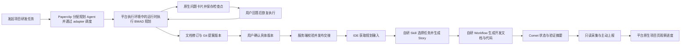

# 团队级 AI 研发平台：产品形态

> 文档性质：产品设计与分阶段验证方案。本文描述目标体验和建议能力，不代表当前 Paperclip 已经实现了这些功能。
> 修订：2026-11-08，明确集中部署、每团队一个 Company，以及 Paperclip 管理 Agent、运行时执行 BMAD 的分工；通过原生任务问答和人工确认交互，保留本地开发、Comet 观察和公司级使用边界。
>
> 2026-11-08 最新确认规模：20 个团队、50 个项目、50 个实际并发规划 Run；必须内网自建，已有 Kubernetes / 数据库运维团队。500 活跃开发工作区只保留为待确认的 Comet 压测假设。当前范围与实施顺序以[总结与风险](enterprise_ai_rd_platform_summary_and_risks.md)及[BMAD 接入计划](plans/2026-11-08-bmad-integration-and-delivery-plan.md)为准，替代此前 100 团队 / 200+ Run 目标。

> 容量边界：团队数、登录人数、开发工作区数与同时执行的规划任务数分别计量。多 Company 支持不代表无限吞吐；数据库连接与查询、平台调度、执行目标资源和模型服务限额需一起验证，不能仅凭团队数量承诺服务器容量。
>
> 基础：以团队工作区为基础，以 Git 仓库为项目载体，以 BMAD 为研发方法，以项目中的研发任务为入口；复用 Paperclip 的 Agent、任务评论、问答和确认交互。开发阶段由用户在本地 IDE 和已有的 Harness 可视化 Dashboard 中完成。

## 1. 产品定位

这是一个面向团队的 AI 研发规划、文档审阅与进度观察平台。用户在项目中发起研发工作，Paperclip 将任务分配给配置好的规划 Agent，通过 adapter 调用平台执行环境中的 OpenCode 等运行时，由运行时加载 BMAD 方法包完成前期分析、规划和方案文档，形成候选任务及验收要求。需要补充信息或作出决定时，Agent 在任务中提问并等待用户回答或确认。

团队成员通过浏览器使用平台规划、问答和审阅功能，无需在个人电脑安装 OpenCode 或 BMAD；平台管理员负责执行环境、模型认证、方法包及仓库访问配置。参与后续本地开发的成员仍需准备已有的 IDE、Git、Harness 和开发工具链。

平台复用原生任务评论、结构化问题卡片和版本确认卡片，不建设独立 AI 聊天中心，也不以多人共同讨论为前提。文档可先发布到 Git 提案版本供审阅；只有满足确认条件的版本才进入后续规划或本地开发交接。

用户在 IDE 中取得这些文档，使用自研 Skill 流程选择要开发的任务并生成 Story，再由自研 Workflow 在项目中生成后续开发文档、代码及验证产物。Story 的具体格式和开发步骤沿用现有本地流程；平台提供输入并观察结果。

用户继续使用熟悉的 IDE 编写代码，并通过现有 Harness Dashboard 管理本地开发过程。平台只读采集项目中的 Comet 状态文件，让团队了解开发阶段、验证摘要和信息新鲜度；开发操作仍由本地环境负责。

平台的主要交互对象是**项目及其研发工作**。每个项目汇集任务问答、决策、研发文档、规划任务、开发交接记录和代码仓库；本地开发成果可通过 commit、PR 和报告关联回项目。

核心原则：

1. **任务是需求入口。** 用户直接描述目标、问题和修改意见，在任务内回答 AI 的问题，不需要先学习 BMAD 命令。
2. **AI 负责组织过程。** 平台根据项目上下文决定使用哪些研发角色和方法，并向用户说明下一步及其理由。
3. **人类掌握决策权。** 必须人工确认的事项由有权限的人处理，AI 不能自行批准。普通评论不替代正式确认。
4. **过程和结果可追溯。** 用户能看到当前进度、关键决策、文档版本、执行结果和阻塞原因。
5. **方法随工作规模调整。** BMAD 是研发方法，不应要求每一项小改动都完成全部规划阶段。
6. **项目内沿用 Paperclip 的交互。** 保留现有项目页面、导航、任务详情、讨论和文档交互，把研发能力接入这些界面。
7. **开发在本地完成。** 用户直接用 IDE 打开项目，沿用已有 Harness Dashboard；平台负责准备开发依据和交接，不重复建设开发操作界面。
8. **进度有来源，验收有依据。** Comet 状态可自动同步，但本地报告、是否在线和团队验收分别展示。

职责分工：

| 环节 | 主要承载位置 |
| --- | --- |
| 团队、项目、任务内问答、规划调度、文档确认 | Paperclip 平台 |
| BMAD 前期规划的实际执行 | 平台管理的 OpenCode 等运行时，通过 adapter 调用 |
| 已确认规划文档、候选任务、验收要求和交接清单 | 平台发布到项目 Git 仓库，本地通过 Git 取得 |
| 选择开发任务、生成 Story | IDE 中的自研 Skill 流程 |
| 生成开发文档、代码、测试及执行记录 | 自研 Workflow + 已有 Harness；产物写入项目 |
| 开发操作及详细过程可视化 | 用户本地 IDE + 已有 Harness Dashboard |
| 跨成员共享的开发阶段、验证摘要和同步状态 | Comet 文件只读采集 → 平台项目及任务详情 |
| 交付结果关联、需求变更确认、团队验收 | 平台关联 Git 及用户提交的结果 |

## 2. 产品对象

| 对象 | 用户理解 | 主要内容 |
| --- | --- | --- |
| 用户 | 使用平台的团队成员 | 账号、团队成员身份、权限 |
| 团队工作区 | 一组人和 AI 协作的空间 | 成员、项目、AI 角色、连接和团队配置 |
| 项目 | 团队正在建设或维护的产品、系统 | 仓库、文档、研发工作和执行记录 |
| AI 研发角色 | 在研发中承担特定职责的 AI 助手 | 职责、运行方式、可用技能和工作记录 |
| 研发工作 | 项目内的一次需求、改进或问题处理 | 目标、任务评论、问答、成果、状态和决策 |
| 研发成果 | 一项工作产生的文档、代码或其他结果 | 内容、关联工作、版本、状态和审阅意见 |
| 开发交接 | 一次将确认资料交给本地开发的动作 | 对应需求、仓库、输入版本、验收标准和交接记录 |
| 开发工作区 | 某成员或开发机上的项目副本 / worktree | 对应仓库、分支、研发工作、Comet 状态和来源健康 |
| Story（本地生成） | 对选中任务形成的具体开发说明 | 引用规划输入版本、来源任务与验收要求，供自研 Workflow 使用 |

一个用户可以属于多个团队，一个团队可以有多个项目，一个项目可以包含多项研发工作。完整形态可以支持一个项目关联多个仓库；PoC 先验证一个项目关联一个已有仓库。

采用一套 `authenticated` 模式的集中部署，每个团队对应一个 Paperclip Company，无需每团队部署一套服务。组织私网使用 `private` exposure；集中部署可以使用服务器或 Docker，也可以扩展为多个应用副本，不等于所有工作必须运行在单台机器。企业统一登录不自动授予全部项目权限，公司级汇总只显示被明确授权的项目。一个项目可同时关联多个开发工作区，不能用一个工作区的状态覆盖所有人的进度。

Company 提供业务数据作用域和访问控制；执行进程、文件系统、网络及凭据的隔离需要另行配置和验证，不能仅凭不同 `companyId` 就宣称运行环境完全隔离。

## 3. 基于 Paperclip 的导航形态

延续 Paperclip 的侧边栏和已有组织方式，调整产品名称并提供“发起规划”入口。进入项目后的呈现方式与 Paperclip 保持一致。

```text
┌────────────────────┐
│ 当前团队      切换 ▼ │
├────────────────────┤
│ 搜索               │
│ 工作台             │
│                    │
│ 项目 PROJECTS      │
│   客户管理系统     │
│   内部知识平台     │
│   + 新建项目       │
│                    │
│ 工作 WORK          │
│   我的待处理       │
│   任务             │
│   研发成果         │
│                    │
│ AI 研发团队 AGENTS │
│   项目协调助手     │
│   产品经理         │
│   架构师           │
│   需求评审         │
│                    │
│ 团队 COMPANY       │
│   团队成员         │
│   角色与权限       │
│   连接与设置       │
└────────────────────┘
```

这是一种目标导航草图，具体布局可在原型阶段调整。当前 Paperclip 的侧边栏会随界面模式和功能开关变化，并非所有安装都显示完全相同的栏目。

| Paperclip 对应能力 | 产品形态中的建议 | 用户主要完成什么 |
| --- | --- | --- |
| Company 与组织管理入口 | 团队工作区及“团队”菜单 | 切换团队、管理成员、权限和配置 |
| Agents | AI 研发团队 | 了解不同 AI 角色的职责、运行状态和工作记录 |
| Projects | 项目 | 发起研发工作、处理问答及查看项目资料 |
| Work、Tasks、Artifacts 等 | 我的待处理、任务和研发成果 | 跨项目查看需要处理的工作与结果 |
| 设置与连接 | 团队连接与设置 | 配置模型、Git 连接和运行环境 |

“团队”既是工作区的产品名称，也包含成员和权限管理入口。**团队权限角色**描述人能做什么；**AI 研发角色**描述 AI 负责什么，两者不应混为一套权限模型。角色名称本身不自动授予仓库或项目访问权限。

开发和测试角色可以作为交接资料中的角色说明，但其执行发生在本地 Harness。平台不为这些角色创建持续运行的云端开发任务。

## 4. 主要页面

### 4.1 团队工作台

用户登录并选择团队后，工作台展示：

- 我可以访问的项目。
- 需要我回答或确认的事项。
- 正在进行的研发工作，以及最近完成或被阻塞的工作。
- 最近参与的规划任务和文档。

工作台帮助用户找到下一步行动。具体的需求讨论和研发上下文仍归属于项目。

### 4.2 项目主页

用户进入项目后，沿用 Paperclip 的项目页及其默认页签、上次访问位置的记忆规则。项目顶部提供“发起规划”入口，创建关联项目的普通研发任务；用户也可以进入已有任务继续处理问题和文档。规划完成后显示“本地开发”入口，展示已确认资料、仓库和交接状态。

下面的示意体现入口关系，具体样式、布局和详情打开方式沿用当前启用的 Paperclip 界面：

```text
┌──────────────────────────────────────────────────────────────┐
│ 项目名称                       [发起规划] [本地开发] [操作] │
│ 项目摘要：当前目标、进展、待确认事项                         │
├──────────────────────────────────────────────────────────────┤
│ 任务          工作区（按条件显示）          配置          预算 │
├──────────────────────────────────────────────────────────────┤
│ 原有任务列表、筛选、状态和负责人                             │
│ 需求分析 / PRD 编写 / 架构设计等研发工作                     │
│                                                              │
│ 打开研发任务 → 原生任务详情、评论、问答、文档、确认交互       │
└──────────────────────────────────────────────────────────────┘
```

项目摘要展示当前目标、相关研发工作的状态和待确认事项。研发阶段及 Comet 开发进度呈现在关联工作的状态和属性中；PRD、架构文档、版本确认和规划运行记录接入现有详情组件。跨工作聚合文档的视图可后续通过同风格页签扩展。

开发摘要例如“本地验证中 · 5 秒前同步”或“本地已归档 · 待团队验收”。用户可查看来源工作区和最近有效信息；详细步骤、日志和开发控制仍进入已有 Harness Dashboard，不在项目页复制一套开发控制台。

“本地开发”提供复制仓库地址、查看交接文档，以及已配置时的“在 IDE 中打开”和“Harness Dashboard”入口。用户也可以直接在 IDE 打开已有本地仓库。IDE 启动方式和 Dashboard 地址以本机实际配置为准；没有本机集成时仍可完成手动打开和开发，不把链接点击当作开发已经开始。

每项研发工作有自己的任务地址、输入和处理记录。沿用原生任务详情即可承载人机交互，不需要创建项目共享会话或改造个人 Agent Chat 的身份模型。

### 4.3 研发任务中的问答与确认

用户在任务描述或评论中提出想法、补充背景、指出冲突，也可以要求 AI 修改已有成果。交互围绕当前研发工作展开，不要求多名成员共同参与同一个聊天会话。

任务详情中复用以下原生内容：

- **问题卡片**：Agent 通过结构化问题收集需求、约束或待决策事项，用户填写后提交。
- **文档**：查看草稿、修改摘要和相关版本。
- **确认卡片**：有权限的人对具体成果版本接受或拒绝；需要调整时在任务中说明修改意见。
- **任务**：查看后续工作的负责人、状态和结果。
- **异常**：说明阻塞原因及可执行的处理方式。

等待用户时，平台保存问题、输入版本和执行检查点，释放本轮执行资源；用户回答后再恢复或重新发起执行。浏览器关闭或服务重启不应丢失待处理事项，也不应让模型持续空转。

必须由人处理的卡片显式采用 `human_only`，必要时指定接收人；评论中的“可以”不自动等同于接受确认卡片。确认绑定具体文档修订，新版本需要重新确认。服务端检查权限和输入版本后才允许下一步，不能只依赖 Agent 提示词遵守顺序。

任务、文档、问答和运行记录都遵循项目可见范围。用户能查看某项工作，不代表有权回答指定给他人的问题、确认文档或执行有副作用的操作。

### 4.4 AI 研发团队

AI 研发团队页面展示平台已经配置的 AI 角色。用户可以查看角色职责、当前状态、参与过的工作及相关运行记录；有权限的管理员可以配置角色的运行方式、技能和访问范围。

| AI 角色 | 产品中的职责示例 |
| --- | --- |
| 项目协调助手 | 理解用户意图、维护上下文、组织下一步工作 |
| 产品经理 | 澄清目标与范围，整理产品简报、PRD、候选任务和验收要求 |
| 架构师 | 理解现有系统，提出架构方案、约束与技术决策 |
| 需求评审角色 | 检查需求、设计和验收标准是否清晰、一致 |
| 开发 / 测试角色（本地） | 在已有 Harness 与 IDE 中执行代码修改和验证，平台仅关联交接及结果 |

Paperclip 是控制平面，管理 Agent 的身份、职责、权限、运行配置、预算和工作记录；adapter 连接 OpenCode、Pi 等实际运行时；BMAD 提供角色指令、Skill / Workflow、模板和方法步骤。通常配置已有运行时即可，不需要自行开发 agent 程序。迁移需要同时绑定这些能力，并将 BMAD 的提问和确认步骤接到任务卡片，不能只复制角色名称或提示词。

以 `opencode_local` 为例，未指定远程执行目标时，它调用 Paperclip server 所在执行环境中的 OpenCode：本机部署时在该电脑，Docker 部署时在容器内，服务器部署时在服务器上。这里的“本地”不指浏览器用户的个人电脑；配置受支持的 SSH 或托管沙箱执行目标后，CLI 在对应目标中运行。安装与认证由平台管理员维护，具体配置见[技术架构方案](plans/2026-11-05-team-ai-development-architecture.md#111-poc-部署与公司级上线边界)。

是否每个 BMAD 角色都对应独立 Agent，由实际工作分工决定。PoC 先用一个产品经理 Agent 和一种运行环境完成规划闭环；用户不必手动选择每一步该调用的角色。

管理员负责规划并发和资源配置。单 Agent 的并发上限与唤醒合并不能替代团队或执行主机的总量控制；繁忙时平台应排队并显示等待原因，不能因多个团队同时发起规划而影响资料查看和人工确认。具体资源限制及容量证据见[公司级补充方案](plans/2026-11-07-comet-progress-and-enterprise-readiness.md#7-容量模型与存储控制)，这些是上线验收要求，不表示当前配置已经满足。

### 4.5 团队成员与权限

团队页面用于管理人类成员的邀请、成员状态和权限；AI 角色可以单独查看和管理。建议初版提供所有者、管理员、项目成员和只读成员等清晰角色，并根据实际职责映射到底层已有授权能力。

项目支持团队可见和项目私有两种产品形态。私有项目还需要明确授权的成员或 AI 才能访问。团队成员被移除后，其后续项目访问和新发起的执行应被拒绝；已在运行中的工作如何终止或收敛，需要遵循明确的执行策略。

### 4.6 公司级项目总览

有相应权限的负责人可以跨团队查看项目、待确认工作、开发进度和阻塞情况，并进入原生项目详情。汇总数量、搜索、导出和实时更新都遵循同一可见范围；普通成员仍只看到被授权的内容。

总览从平台已接收的状态投影汇总，清楚区分已同步、过期和采集异常。它不能通过查看页面临时扫描所有员工电脑，也不能把未回报的项目计为没有进展。

## 5. 从想法到研发的用户旅程

下面以“销售团队的客户跟进系统”为例。

### 第一步：创建项目并描述想法

用户输入项目名称，选择一个有权限访问的已有仓库，也可以暂不关联仓库。进入项目后点击“发起规划”，在任务描述中输入：

> 我想做一个帮助销售团队整理客户跟进记录的系统。我们现在主要用企业微信和 Excel。

### 第二步：AI 澄清目标

产品经理 Agent 根据 BMAD 方法了解目标用户、当前问题、业务范围和重要约束；它将事实、假设和待决策问题分别呈现，通过问题卡片向用户收集答案。缺少必要回答时保存进度并等待，收到有效答案后继续。

### 第三步：形成产品简报和 PRD

平台组织适当的 BMAD 研发能力，形成产品简报或 PRD 草稿。用户可以在任务评论中要求调整，或者在文档中提出修改意见。

成果中应区分已确认内容和未解决问题；信息不足时，AI 应保留问题或明确说明假设。

### 第四步：团队确认

有权限的成员查看某一具体版本，通过人工确认卡片接受或拒绝。确认记录关联确认人、时间和成果版本；文档后续变化时，旧确认保留为历史，新版本不能沿用旧批准。Agent 自行接受或未经授权者代答均不应推进工作。

### 第五步：方案与任务

服务端核对所需回答、确认和输入版本后，平台可以组织架构分析，形成候选开发任务及依赖、验收要求。用户能够看到任务与需求、文档、仓库的关联。候选任务提供待选工作范围，实际选择和 Story 细化由 IDE 中的自研 Skill 流程完成。

### 第六步：交接给本地 IDE 与 Harness

平台将已确认的 PRD、架构、候选任务、验收要求和代码基线整理为版本固定的交接清单，发布到项目 Git 仓库。用户在 IDE 中打开本地项目，通过 Git 获取对应版本；平台同步到远端仓库不等于已经改动了每个成员的本地目录。

本地自研 Skill 读取这些输入及当前代码上下文，让用户选择任务并生成 Story。自研 Workflow 再消费 Story，按现有规则生成开发文档、代码和验证产物，写入项目并更新 Comet 进度。用户通过已有 Harness Dashboard 查看详细过程并处理本地决策。

### 第七步：同步进度、关联交付结果与需求变更

本地只读采集器从 Comet 文件取得开发阶段和验证摘要，主动上报给平台；团队在原有项目界面查看进度。用户还可以把 commit、PR 或测试报告关联回平台，供团队验收；交付证据初版允许手动关联。需求变化时回到关联规划任务，补充变更并形成新的确认版本，再交接给本地开发。

平台保存交接及验收记录；本地开发过程、工具许可、运行控制和详细日志继续由 IDE 与 Harness 管理。平台账号和 Git 访问凭据分别授权，平台暂停项目并不意味着本机进程已经停止。



## 6. 研发流程与状态

产品可以使用 Analysis、Planning、Solutioning、Implementation 帮助用户理解研发活动，同时允许按需求规模省略、重复或返回某些活动。前三类工作由平台组织；Implementation 表示已交接到本地开发，平台显示 Comet 进度摘要，详细过程在已有 Harness Dashboard 中查看。

用户默认看到易理解的工作状态：

| 状态 | 含义 |
| --- | --- |
| 澄清中 | 正在澄清目标、背景或约束 |
| 规划中 | 正在整理需求、设计或实施计划 |
| 等待回答 | 必要问题尚未得到有效回答，Agent 已保存执行检查点 |
| 等待确认 | 具体成果版本需要有权限的人确认，尚不允许推进依赖阶段 |
| 可交接开发 | 本次开发需要的资料已确认并具有可获取的版本 |
| 已交接本地 | 已生成交接记录，不代表本机已启动或持续在线 |
| 本地开发中 / 验证中 | 由 Comet 采集反馈，显示来源、采集健康及更新时间；手动报告单独标记 |
| 待验收 | 用户已关联本地交付结果，等待团队确认 |
| 已阻塞 | 缺少信息、权限，或执行遇到问题 |
| 已完成 | 约定的成果及必要验证已完成 |

这些状态按研发工作展示，不应假设整个项目只能处于同一个阶段。一次需求变化可以引发相关文档、任务或决策的重新审视。本地离线或未回传进度时，平台展示“状态未更新”，不推断失败或完成。

Comet 的阶段、运行状态和验证结果用于反映本地事实，不直接改写平台确认。进入 Comet `archive` 或本地 Run 完成，不代表团队已经验收；验收仍关联明确的交接、代码版本和证据。

“实时”定义为在线且采集正常条件下的近实时同步；建议以 p95 不超过 5 秒、p99 不超过 15 秒作为待验证目标。用户电脑离线、状态文件无效或版本不支持时，展示最后有效信息和原因。仅通过 Git 读取已推送文件的项目应注明这一限制，不能展示为本地实时状态。

## 7. 项目文档与 Git

产品建议采用以下分工：

- **任务描述、评论、问答、人工决定、规划运行和交接记录**保存在平台。
- **正式研发文档与代码**以项目指定 Git 仓库中的文件作为版本载体。
- **平台成果视图**关联仓库、路径、分支和可识别的版本信息，方便查看和审阅。
- **本地开发过程与详细日志**由已有 Harness Dashboard 承载；平台只读接收 Comet 状态投影并关联必要交付证据，不默认上传全部源码或日志。

文档中心需要让用户查看 Markdown、生成或修改摘要、版本差异和审阅意见。PoC 可以先支持草稿查看、修改建议、版本确认及 Git 变更展示，不要求首先实现多人实时编辑。

平台必须处理仓库未关联、用户或 Agent 缺少仓库权限、写入失败、外部修改和版本冲突等情况。项目绑定仓库并不等于向每个团队成员或 AI 自动授予仓库权限。

规划文档由平台生成、修订并确认；Story、实施说明、开发验证报告和代码由本地流程生成。平台可关联和展示这些本地产物，但不会因观察到文件变化就自动确认其内容。两端修改同一份规划文档时走差异审阅和版本更新，不能相互覆盖。

交接和回传至少能串起“规划文档版本 → 来源任务 → 本地 Story → 工作区 / 分支 → 代码与验证结果”。沿用现有文件格式和标识；尚无对应关系时先明确映射，不能只靠任务名称猜测。开发中发现需求变化，应回到关联规划任务形成新的确认版本，并提示哪些 Story 的输入已经过期。

## 8. 与 Paperclip、BMAD 的关系

### Paperclip 提供基础

优先评估复用团队与项目管理、用户认证、成员权限、Agent 运行、任务、审批、文档和工作产物等能力，以及现有界面风格。

当前 Paperclip 已有任务内问题和确认交互，以及 Cases / Workflow 等基础，但需要注意：

- 原生问题和确认卡片可以承载人机交互；必须显式限制人工处理策略，并验证答案投递、恢复和版本失效规则。
- 本方案不依赖 Agent Chat，不修改个人会话身份，也不新增共享聊天能力。
- Cases 已有阶段和交接相关能力；现有 Workflow 主要承载可复用指令，并不自动构成满足本产品要求的完整流程引擎。
- 已有文档修订和工作产物能力，但不能直接假定它们与项目 Git 文件自动同步。

因此，PoC 应优先验证现有能力如何组合，再决定需要扩展哪些核心边界；不预先要求新增一整套平行的流程、执行和产物模型。

### BMAD 提供研发方法

平台通过配置好的 AI 运行环境使用指定版本的 BMAD 角色、技能、工作流及模板；适配其输入、提问、等待、恢复和产物步骤。PoC 应固定版本并记录配置，验证真实调用和产物；不能仅因生成了 PRD 就认定 BMAD 已成功接入。

### 项目协调能力串联过程

产品需要维护项目上下文，关联任务描述、问答、规划工作、成果版本和确认记录，并生成供本地开发使用的交接资料。平台仍需执行 BMAD 前期规划的 AI 能力；开发阶段由已有 Harness 工程负责，Comet 观察能力在其现有本地服务中复用或补充。实际版本、导入、打开及采集接口需在接入时核实。

## 9. PoC 范围

### 目标

验证一个用户能否通过一个产品经理 Agent，在原生任务中完成“提出需求 → 回答问题 → 生成 PRD → 确认具体版本 → 继续流程”，并能将该版本作为交接资料在本地 IDE 中获取。PoC 固定一种支持的 Runtime 和一条 BMAD 规划 Workflow；完整开发交接还包含实际所需的架构、任务与验收标准。

第一项工程工作是把固定 BMAD 方法资产及其依赖接入这个 Agent 的实际执行环境，经现有 Company skills 验证加载、问答与恢复；不以给 Paperclip 源码开发助手安装技能作为产品接入完成。先使用现有普通任务入口做通，再增加项目入口和更多角色；完整步骤见[BMAD 接入计划](plans/2026-11-08-bmad-integration-and-delivery-plan.md)。

### 范围

1. 启用用户登录，创建或选择团队，并保证基本团队数据隔离。
2. 创建项目，关联一个已有 Git 仓库。
3. 在项目中创建普通规划任务，配置产品经理 Agent 和 BMAD 方法包。
4. Agent 使用原生问题卡片澄清需求，保存检查点，收到用户回答后继续生成 PRD 草稿。
5. 查看和修改草稿，展示对应 Git 变更或版本。
6. 由有权限的成员通过 `human_only` 卡片确认具体版本；服务端校验后继续流程，并保留确认记录。
7. 展示失败、权限不足和需要人工处理的状态。
8. 生成最小交接清单，用户用 IDE 打开仓库并定位正确的文档版本；本地开发沿用现有 Harness Dashboard。

### 验收场景

- 用户在原生任务中收到问题、提交答案并看到 Agent 从正确步骤继续；等待期间不持续占用模型执行资源。
- 指定接收人及人工确认限制生效；Agent 不能自行批准，普通评论不代替正式确认。
- 另一个团队的用户无法通过列表、搜索、直接链接或文件接口读取该项目。
- 用户可以要求 AI 修改 PRD，并看到修改与先前版本的差异。
- 确认记录能指向明确的文档版本；文档再次变化不会被误认为仍是已确认版本。
- 运行记录能证明所配置 BMAD 版本被实际调用，并能检查生成结果。
- 等待中重启、重复提交答案、Agent 运行中断或仓库写入失败时，平台保留真实状态，不重复推进、不重复制造已完成的结果。
- 用户在本地打开项目后能找到本次确认的文档，平台不会自动启动开发 Agent；没有本机启动集成也能手动交接。

## 10. 后续演进

PoC 成功后，扩展架构设计、候选任务整理、完整开发交接、Comet 进度同步和交付结果关联。本地 Skill 承接任务选择与 Story 生成，自研 Workflow 承接开发文档、代码和验证。跨团队权限、成果审阅、仓库冲突处理、规划 Agent 运行恢复和审计随平台范围同步完善。

面向 20 团队、50 项目、50 Run 的正式上线，验证单活控制平面与受控接管、HA 数据库、隔离执行池和持久存储；单活不等于单机部署。API 长期多活须另行验证通知与后台所有权。按 BMAD 闭环、可靠控制、Git 交接、多团队隔离、Comet、生产验收依次推进；单团队 PoC 不替代后续门槛。部署决策见[当前总结](enterprise_ai_rd_platform_summary_and_risks.md)，进度契约见[公司级补充方案](plans/2026-11-07-comet-progress-and-enterprise-readiness.md)。

后续可以评估多仓库、多方法论和更灵活的自动化策略，但这些能力应由实际使用场景驱动。

## 11. 待验证和待决定的问题

1. 选定 Runtime 如何将 BMAD 提问、人工确认及等待 / 恢复步骤映射到原生交互，能否在重启和重复提交下正确继续。
2. Cases、任务、审批和工作产物能否满足阶段状态及版本确认要求；哪些状态需要新增。
3. 固定版本的 BMAD 能否在选定 Runtime 中稳定加载、执行、恢复并产生可追溯结果。
4. 仓库首次授权、分支策略、文档写入时机和冲突处理采用什么具体交互。
5. 人类团队成员的默认权限、项目私有规则，以及 Agent 代用户执行时的授权边界如何映射到底层。
6. 目标产品与 Paperclip 的差异中，哪些可以通过配置或插件实现，哪些需要维护核心改造。
7. 现有 Harness 如何读取交接文档，以及已有的 IDE 入口、项目识别、Comet 只读采集和结果导出接口。Comet Classic 状态格式已定向核实，但用户实际安装版本和采集能力仍需实测。
8. 已确认内网 Kubernetes、数据库运维条件及 50 规划并发；仍需确定身份提供方、物理故障域、备份、模型吞吐和保留策略。500 工作区为待确认的进度压力假设，性能与恢复数字仍是待验证目标。

## 12. 参考材料

- [团队级 AI 研发平台技术架构方案](plans/2026-11-05-team-ai-development-architecture.md)
- [Comet 开发进度接入与公司级部署方案](plans/2026-11-07-comet-progress-and-enterprise-readiness.md)
- [总结与风险：当前 20 团队 / 50 项目 / 50 Run](enterprise_ai_rd_platform_summary_and_risks.md)
- [BMAD 接入与实施计划](plans/2026-11-08-bmad-integration-and-delivery-plan.md)
- [历史 100 团队 / 200+ Run 扩容参考](plans/2026-11-08-on-prem-100-teams-deployment.md)
- [Paperclip 产品定义](PRODUCT.md)
- [Paperclip 当前实现契约](SPEC-implementation.md)
- [Paperclip 部署与认证模式](DEPLOYMENT-MODES.md)
- [Agent 运行机制与执行风险](../docs/agents-runtime.md)
- [Adapter 与执行目标](../docs/adapters/overview.md)
- [Paperclip 可复用 Case Workflow 设计](plans/2026-10-21-reusable-case-workflows.md)
- [BMAD 官方安装文档](https://docs.bmad-method.org/start/install-bmad/)
- [BMAD Skills 与 Agents](https://docs.bmad-method.org/reference/skills-and-agents/)
